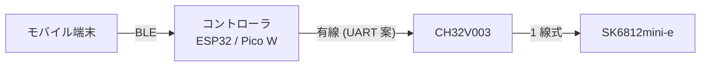

# HALO

CH32V003 で SK6812mini-e(アドレサブル LED)を制御する、リング状ライティング「HALO」のプログラムと関連データを管理するリポジトリ。
ESP32 / Raspberry Pi Pico W を介して、モバイル端末から BLE でライティングのプリセットを書き込み・呼び出しできる。

## 全体構成



- **CH32V003**: LED を制御する。HALO の種類ごとに変わる固定情報(固定プリセット 3 パターン、LED の個数と偏角)をファームウェアに持つ。
- **コントローラ**: モバイル端末から BLE で受けたプリセットを CH32V003 に書き込み・呼び出す。
- 各デバイスは **疎結合**。互いのソースを参照せず、仕様書化したプロトコルだけを契約にする。

## ディレクトリ構成

monorepo。デバイス・役割ごとにトップレベルのディレクトリを分け、1 ディレクトリが 1 機能(CI のビルド単位)になる。

| ディレクトリ | 役割 |
| --- | --- |
| [halo-controller-ch32v003/](halo-controller-ch32v003/) | CH32V003 で SK6812mini-e を制御するファームウェア |
| `halo-link/` | 単線半二重通信のライブラリ(A・B 側で共有。仕様は [docs/halo-link-spec.md](docs/halo-link-spec.md)) |
| `halo-bridge/` | I2C ブリッジのライブラリ(ESP32 / Pico W ⇔ B 側の CH32V003。仕様は [docs/halo-bridge-spec.md](docs/halo-bridge-spec.md)) |
| `halo-controller/` | B 側(マスター)の CH32V003 版。A 側へプリセット実行・LED 直接制御・情報要求を送る |
| `halo-controller-esp32/` | ESP32 側。B 側へ I2C でつなぎ、A 側を操作する(ビルド・実機は未確認) |
| `halo-controller-picow/` | Pico W 側。B 側へ I2C でつなぎ、A 側を操作する(ビルド・実機は未確認) |
| `halo-pcb-ch32v003/` | CH32V003J4M6 のコントローラ基板の回路図(KiCad) |
| [docs/](docs/) | 設計メモ・仕様書(デバイス間プロトコルなど) |
| `.github/` | GitHub Actions、PR テンプレート、CODEOWNERS |
| `.claude/skills/` | 反復作業の手順(エージェント向け skill) |
| `scripts/` | リポジトリ共通のスクリプト |

プログラムのほか、図面データ、プロジェクトロゴ(アイコン)なども、このリポジトリで管理する(今後追加)。

## 現在の状況

| 項目 | 状況 |
| --- | --- |
| CH32V003 ファームウェア | 下地あり(SK6812 ドライバ、variant による固定情報、点灯デモ)。実機では未検証 |
| プリセット書き込み方式 | 設計メモあり([docs/preset-write-methods.md](docs/preset-write-methods.md))。UART コマンド方式を推奨。実装は未着手 |
| コントローラ(ESP32 / Pico W) | 未着手 |
| モバイルアプリ | 未着手 |

## はじめに

### 開発環境

```bash
git clone https://github.com/oldsheeep/HALO.git
cd HALO
pip install pre-commit   # または brew install pre-commit
pre-commit install       # コミット時に差分へ linter / formatter を自動適用
```

各デバイスのビルド・書き込みは、そのディレクトリの README を参照する(例: [halo-controller-ch32v003/README.md](halo-controller-ch32v003/README.md))。

### 開発の流れ

1. `develop` から **git worktree** を切って作業する(メインのチェックアウトでは作業しない)。
2. ブランチ名は `<type>/<scope>-<summary>`(例: `feature/controller-ch32v003-sk6812-driver`)。
3. `develop` 向けに PR を出し、label `scope:<scope>` を付ける。
4. `develop` に push されると、`develop` → `main` の PR が自動で作られる。
5. `main` にマージされると、**差分のあるディレクトリだけ** がビルドされ、release が作られる。

緊急で `main` に直接反映したいとき(緊急ビルド、CI の修正)は `hotfix/*` ブランチを `main` から切る。マージ後は `main` → `develop` の同期 PR を必ずマージする。

詳しいルールは [CLAUDE.md](CLAUDE.md) と [AGENTS.md](AGENTS.md)、手順は `.claude/skills/` の skill(`pr` / `ci` / `hotfix`)を参照。

## CI/CD

| 仕組み | いつ | 何をする |
| --- | --- | --- |
| pre-commit | コミット時 | 差分に linter / formatter を auto fix |
| Lint & Format | PR | 差分を検査(error はブロック、warn は警告のみ) |
| Auto PR to main | `develop` への push | `develop` → `main` の PR を作成・更新 |
| Auto PR for hotfix | `hotfix/**` への push | `main` 向けの PR を作成・更新 |
| Sync main to develop | `main` への push | hotfix を `develop` に取り込む PR を作成 |
| Build & Release | `main` への push | 差分のあるディレクトリをビルドし、release を作成 |

`halo-*/scripts/build.sh` を持つディレクトリがビルド対象になる。release には、差分のないディレクトリの成果物も前回の release からコピーして載せる。
詳細は `.claude/skills/ci/SKILL.md`。

## ライセンス

Copyright (c) 2026 sheeplab

- **プログラム・図面など**: [PolyForm Noncommercial License 1.0.0](LICENSE)。非商用の利用・改変・再配布は自由。**商用利用は要相談**で、[GitHub の Issue](https://github.com/oldsheeep/HALO/issues) から連絡する。コピーライト表示は必須ではないが、再配布するときは [LICENSE](LICENSE) を同梱する。
- **プロジェクトロゴ・アイコン**: All rights reserved(無断での利用・再配布は不可)。ロゴは `assets/logo/` に置き、そこに同じ旨の `LICENSE` を置く。
- **第三者のソフトウェア**: ch32fun(MIT)などは [THIRD_PARTY_NOTICES.md](THIRD_PARTY_NOTICES.md) を参照。release の成果物にも `LICENSE` と `THIRD_PARTY_NOTICES.md` を同梱する。
