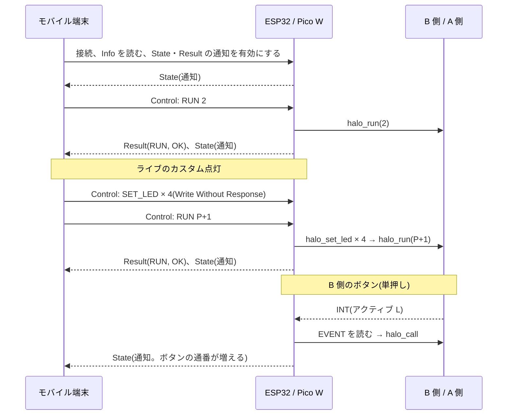

# HALO BLE: モバイル端末と ESP32 / Pico W の BLE 仕様(草案)

- 状態: 草案(コードは含まない。合意後に、ライブラリ `halo-ble` と、各 MCU の GATT を実装する)
- 対象: モバイル端末(セントラル)と、ESP32 / Raspberry Pi Pico W(ペリフェラル = GATT サーバー)の間の BLE
- 関連: [halo-bridge-spec.md](halo-bridge-spec.md)(ESP32 / Pico W ⇔ B 側)、[halo-link-spec.md](halo-link-spec.md)(`halo_t` の API)、[halo-button-spec.md](halo-button-spec.md)

## 1. 方針

| 項目 | 内容 |
| --- | --- |
| 役割 | ESP32 / Pico W = ペリフェラル(GATT サーバー)。モバイル端末 = セントラル |
| モバイル側の実装 | **未定**(ネイティブ / Flutter / React Native / Web Bluetooth のどれでも動くよう、標準的な GATT だけを使う) |
| 接続 | 同時に 1 台のセントラルだけ |
| セキュリティ | v1 は**認証なし**(近くの誰でも、つないで操作できる)。ペアリングは v2 以降(8 節) |
| できること(v1) | 固定プリセットの選択、消灯 / 点灯、明るさ、カスタム点灯(ライブ)、状態の通知、**カスタムプリセットの保存と再生**(ESP32 / Pico W に保存) |
| A 側のデータ | 通信で書き換えない([halo-link-spec.md](halo-link-spec.md))。カスタムプリセットは ESP32 / Pico W が保存し、ESP32 / Pico W が描画して、A 側へ送る |

```text
モバイル端末 ── BLE (GATT) ── ESP32 / Pico W ── I2C ── B 側 CH32V003 ── 単線 ── A 側 CH32V003
```

## 2. アドバタイズ

| 項目 | 内容 |
| --- | --- |
| デバイス名 | `HALO-XXXX`(`XXXX` = BLE アドレスの下位 2 バイトの 16 進。大文字) |
| アドバタイズのデータ | フラグ + **サービス UUID(128 ビット)**。デバイス名は、スキャン応答に入れる(31 バイトに収めるため) |
| 間隔 | 接続していないあいだ、最初の 30 秒は 100 ms、その後は 1 秒 |
| 切断後 | 自動でアドバタイズを再開する |

## 3. GATT

サービスは 1 つ。UUID は、ランダムに作った仮の値(出荷前に変えない限り、そのまま使う)。

| 名前 | UUID | プロパティ | サイズ |
| --- | --- | --- | --- |
| **HALO サービス** | `7f3c0000-1d4e-4b6a-9c80-4a41c4f1e200` | | |
| Control | `7f3c0001-1d4e-4b6a-9c80-4a41c4f1e200` | Write、Write Without Response | 最大 20 バイト |
| Result | `7f3c0002-1d4e-4b6a-9c80-4a41c4f1e200` | Notify | 最大 20 バイト |
| State | `7f3c0003-1d4e-4b6a-9c80-4a41c4f1e200` | Read、Notify | 8 バイト |
| Info | `7f3c0004-1d4e-4b6a-9c80-4a41c4f1e200` | Read | 8 バイト |

- **MTU は、既定の 23 バイト(ATT のペイロード 20 バイト)で足りる**ように、すべてのデータを 20 バイト以内にする。MTU を広げても、仕様は変わらない。
- 多バイトの値は、リトルエンディアン。
- セントラルは、接続したら、Result と State の通知を有効にする(CCCD に書く)。

### 3.1 Info(読み出し専用)

| byte | 内容 |
| --- | --- |
| 0 | BLE 仕様の版(v1 = `1`) |
| 1 | 予約(`0`) |
| 2〜3 | LED の個数(A 側の HELLO の値。A 側と未接続なら `0`) |
| 4 | 固定プリセットの数(`P`) |
| 5 | カスタムプリセットのスロット数(`8`) |
| 6 | `SET_LED` の 1 回の最大 LED 数(`4`) |
| 7 | 予約(`0`) |

### 3.2 State(読み出し / 通知)

| byte | 内容 |
| --- | --- |
| 0 | `mode`: `0` = AUTO、`1` = PRESET、`2` = DIRECT(ライブのカスタム点灯)、`3` = OFF、`4` = CUSTOM(保存したカスタムを再生中) |
| 1 | `current`: `0` = 消灯、`1`〜`P` = 固定プリセット、`0x40` = ライブのカスタム点灯、`0x80` + スロット番号 = 保存したカスタム、`0xFF` = 不明 |
| 2 | 明るさ(0〜255) |
| 3 | フラグ: bit0 = A 側と通信できている、bit1 = B 側(I2C)と通信できている |
| 4 | 使用中のカスタムのスロット(ビットマップ。bit *n* = スロット *n*) |
| 5 | B 側のボタンのイベントの通番(増えたら、ボタンで変わった) |
| 6〜7 | 予約(`0`) |

通知する契機: コマンドを実行したあと、B 側のイベント(INT)で状態を読み直したあと、接続の確立のとき。通知は、**多くても 10 回 / 秒**に抑える。

## 4. コマンド(Control に書く)

先頭の 1 バイトが、コマンド番号(`op`)。

| op | 名前 | ペイロード | 動作 |
| --- | --- | --- | --- |
| `0x01` | RUN | `n`(u8) | `halo_run(n)`: `0` = 消灯、`1`〜`P` = 固定プリセット、`P + 1` = ライブのカスタム点灯を表示(SHOW) |
| `0x02` | BRIGHTNESS | `v`(u8) | 全体の明るさ(`halo_set_brightness`) |
| `0x03` | SET_LED | `start`(u8)、`n`(u8、1〜4)、RGB × `n` | LED を `start` から `n` 個設定(ステージングに書く。表示は `RUN P+1` で変わる) |
| `0x04` | FILL | `r`、`g`、`b` | 全 LED を同じ色にする(ステージング) |
| `0x05` | AUTO | なし | A 側のデモ動作に戻す(`APPLY_PRESET 0xFF`)。`halo-link` の `halo_run` には無いので、`halo_auto()` を足す必要がある(9 節) |
| `0x10` | CUSTOM_SAVE | `slot`(u8、0〜7)、プリセット 16 バイト | カスタムプリセットを保存する(5 節) |
| `0x11` | CUSTOM_DELETE | `slot` | スロットを空にする |
| `0x12` | CUSTOM_PLAY | `slot` | 保存したカスタムを再生する(ESP32 / Pico W が描画する) |
| `0x13` | CUSTOM_READ | `slot` | スロットの内容を、Result で返す |

- `CUSTOM_SAVE` は、`op` + `slot` + 16 バイト = 18 バイトで、20 バイトに収まる。
- ライブのカスタム点灯の手順: `SET_LED`(を LED の個数に応じて数回)→ `RUN P+1`。LED 15 個なら、`SET_LED` 4 回 + `RUN` 1 回。
- **`RUN`・`AUTO`・`SET_LED`・`FILL` を実行すると、保存したカスタムの再生は止まる**(`BRIGHTNESS` は止めない)。
- **最新が優先**(coalesce): `SET_LED`・`FILL`・`BRIGHTNESS` は、処理が追いつかないとき、古いものを捨てて、最新のものだけ実行する。キューは 8 件。あふれたら、`QUEUE_FULL` を返す。
- セントラルは、`SET_LED` / `FILL` / `BRIGHTNESS` を、**多くても 20 回 / 秒**に抑える(スライダーなどで連続して送るとき)。

## 5. カスタムプリセット

### 5.1 形式(16 バイト。A 側の固定プリセットと同じ形式)

| byte | 内容 |
| --- | --- |
| 0 | `brightness`: このプリセットの明るさ(0〜255) |
| 1 | `color_count`: 色の数(1〜4) |
| 2〜3 | `period_ms`: 一周(360°)回る時間[ms](u16)。`0` なら静止 |
| 4〜15 | 色 RGB × 4(未使用の分は `0`) |

色は、円周に等間隔で並び、隣同士を線形補間する(最後の色は、最初の色へ戻る)。`period_ms` が `0` でなければ、模様が、偏角の増える向きへ回る。

### 5.2 描画(ESP32 / Pico W が行う)

LED *i* の偏角 θ*i*(A 側の `GET_ANGLES` で、接続時に読んでキャッシュする。読めなければ、等間隔)と、時刻から、色を求める。A 側の固定プリセットと同じ式:

```text
phase  = (period_ms == 0) ? 0 : (t mod period_ms) × 360 / period_ms
pos    = (θ_i + 360 − phase) mod 360
scaled = pos × color_count
idx    = scaled / 360              frac = scaled mod 360
色     = (colors[idx] × (360 − frac) + colors[(idx+1) mod color_count] × frac) / 360
出力   = 色 × brightness / 255
```

- 静止(`period_ms = 0`)は、1 回だけ、`SET_LEDS` + `SHOW` で送る。
- 回るものは、フレームごとに、`SET_LEDS` + `SHOW` を送る。LED 15 個なら、1 フレームに約 20 ms(`SET_LEDS` 5 回 + `SHOW`)かかるので、**最大 25 fps 程度**。遅れたときは、フレームを飛ばして、時刻に合わせる(位相は、時刻から計算する)。
- 再生中も、全体の明るさ(`BRIGHTNESS`)は、A 側の値が掛かる。

### 5.3 保存

- スロットは 8 個。ESP32 は NVS、Pico W は内蔵フラッシュの最後のセクタに保存する(電源を切っても残る)。
- 保存は、**値が同じなら書かない**(フラッシュの摩耗を避ける)。
- 起動時の再生は、v1 では無し(起動後は、A 側の状態のまま)。

## 6. Result(通知)

コマンドの結果。1 コマンドにつき、高々 1 回。

| byte | 内容 |
| --- | --- |
| 0 | `op`(どのコマンドの結果か) |
| 1 | `status` |
| 2〜 | データ(`CUSTOM_READ` のとき、`slot` + 16 バイト) |

| status | 名前 | 意味 |
| --- | --- | --- |
| `0x00` | OK | 成功 |
| `0x01` | BAD_OP | 未知の `op` |
| `0x02` | BAD_ARG | 引数が範囲外、長さ違い |
| `0x03` | QUEUE_FULL | キューがあふれた(コマンドは捨てた) |
| `0x04` | LINK_ERROR | A 側と通信できなかった(B 側のタイムアウトなど) |
| `0x05` | NOT_READY | まだ A 側に接続できていない |
| `0x06` | STORAGE_ERROR | 保存に失敗した |
| `0x07` | EMPTY_SLOT | 空のスロット(`CUSTOM_PLAY` / `CUSTOM_READ`) |

- `RUN`・`AUTO`・`CUSTOM_*` は、成功も失敗も、必ず Result を返す。
- `SET_LED`・`FILL`・`BRIGHTNESS` は、**失敗したときだけ** Result を返す(OK は返さない。通知の量を減らすため)。

## 7. 流れ



- B 側のボタンで状態が変わったら(INT と EVENT)、ESP32 / Pico W は、`halo_call` で状態を読み直し、State を通知する。**保存したカスタムを再生中なら、ボタンのイベントで再生を止める**。

## 8. セキュリティ(v2 以降)

v1 は、認証なし。近くの誰でも、HALO を操作できる。v2 以降の候補:

- Just Works のペアリング(暗号化。近くの人が勝手につなぐのは防げない)
- 固定の 6 桁パスキー(Static passkey): ESP32 / Pico W に画面が無いので、アプリに入力する
- ボタン長押しで「ペアリングを許可する時間」を作る

## 9. 実装の分け方(案)

| ディレクトリ | 内容 |
| --- | --- |
| `halo-ble/`(新規) | **MCU に依存しない C99 のライブラリ**。コマンドの解析、State / Info / Result の符号化、カスタムの保存の呼び出し(ストレージのインターフェース)、描画(5.2)、コマンドのキューと最新優先、`halo_t` / `halo-bridge` への変換。ホストでテストする |
| `halo-controller-esp32/` | NimBLE(ESP-IDF)の GATT、NVS のストレージ、`halo-ble` の呼び出し |
| `halo-controller-picow/` | BTstack(Pico SDK)の GATT(`.gatt` ファイル)、フラッシュのストレージ、`halo-ble` の呼び出し |

`halo-ble` は、`halo-link` と `halo-bridge` に依存する。

### 実装タスク

1. `halo-link`: `halo_auto()` を足す。`halo-ble`: コマンドの解析と符号化、State / Info / Result、`halo_t` への変換(ホストのテスト)
2. `halo-ble`: カスタムプリセットの描画とストレージのインターフェース(ホストのテスト。A 側の固定プリセットと同じ式であることを、テストのベクタで確認)
3. ESP32: NimBLE の GATT + NVS
4. Pico W: BTstack の GATT + フラッシュ
5. モバイルのアプリ(技術は未定)

## 10. 未決事項

| ID | 内容 | 案 |
| --- | --- | --- |
| L1 | モバイルのアプリの技術 | 未定。GATT は標準的なものだけを使っているので、どれでも対応できる |
| L2 | UUID | 仮の値。出荷前に、確定する |
| L3 | カスタムの再生の最大 fps | LED 15 個で 25 fps 程度。数が増えると、落ちる。必要なら、B 側に「プリセットを渡して B 側で描画する」機能を足す(A 側のデータは書き換えない方針と、整合を取る) |
| L4 | 認証 | v1 は無し(8 節) |
| L5 | 起動時の自動再生 | v1 は無し。必要なら、「起動時に再生するスロット」を、保存する |
| L6 | 複数の HALO を 1 台のモバイルで操作 | v1 は、1 接続 = 1 台 |
| L7 | カスタムの共有(アプリから書き出し・読み込み) | アプリ側の機能。`CUSTOM_READ` / `CUSTOM_SAVE` で足りる |
