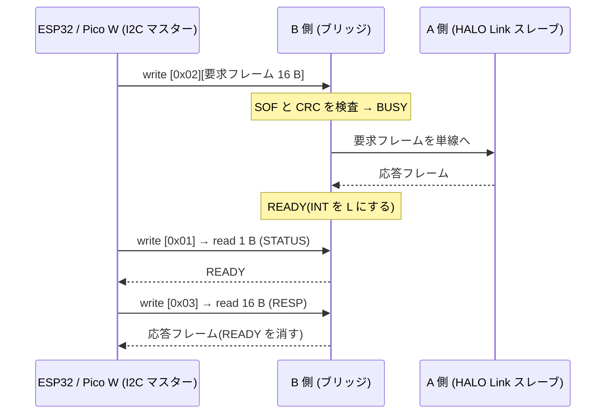

# HALO Bridge: I2C ブリッジの仕様(草案)

- 状態: 草案。ライブラリ `halo-bridge` は、この仕様に沿って実装済み(ホストのテストのみ。実機は未確認)
- 対象: ESP32 / Raspberry Pi Pico W(I2C マスター)と、B 側の CH32V003(I2C スレーブ)の間の通信
- 関連: [halo-link-spec.md](halo-link-spec.md)(B 側と A 側の単線通信)

## 1. 目的と構成

ESP32 / Pico W は、ジャックの通信線につながない。B 側の CH32V003 に I2C でつなぎ、B 側が [HALO Link](halo-link-spec.md) のフレームを A 側へ中継する。

```text
ESP32 / Pico W (3.3V)  ── I2C ──  B 側 CH32V003 (5V)  ── 単線 (HALO Link) ──  A 側 CH32V003
   I2C マスター                      I2C スレーブ + ブリッジ                       HALO Link スレーブ
```

- ESP32 / Pico W は、**HALO Link と同じ 16 バイトのフレーム**を、そのまま B 側へ書く。B 側は、検査(SOF と CRC)だけして、単線に流し、A 側の応答フレームを、そのまま返す。
- そのため、ESP32 / Pico W は、`halo-link` のマスター API(`halo_new`・`halo_run`・`halo_set_led` など)を、**ポートだけ I2C に差し替えて**、そのまま使える。
- ESP32 / Pico W は、ジャックにつながらない。抜き差しの一瞬に Ring の 5V が触れても、ESP32 / Pico W には届かない。

## 2. 物理層

| 項目 | 内容 |
| --- | --- |
| ピン(B 側) | PC1 = SDA、PC2 = SCL(I2C1 の既定ピン。どちらも 5V トレラント `FT`) |
| 合図(任意) | PA2 = INT。オープンドレイン、アクティブ L(5 節) |
| 速度 | 100 kHz(標準)。400 kHz(高速)も可 |
| プルアップ | **ESP32 / Pico W 側の 3.3V へ** 4.7kΩ(SDA・SCL とも)。INT を使うなら、INT も 3.3V へ 10kΩ。B 側(5V 駆動)には付けない |
| GND | ESP32 / Pico W と B 側で**共通**にする(コネクタに GND を含める) |
| 電圧 | B 側は VDD = 5V だが、I2C はオープンドレインで L に引くだけなので、3.3V の ESP32 / Pico W に 5V は出ない。B 側の入力 H の閾値は VDD = 5V で約 2.06V なので、3.3V の H を読める |

## 3. I2C スレーブ(B 側)

| 項目 | 値 |
| --- | --- |
| アドレス(7 ビット) | 既定 `0x32`(`HALO_BRIDGE_DEFAULT_ADDR`。ビルドで変更できる) |
| モデル | **レジスタ方式**。書き込みの先頭の 1 バイトが、レジスタ番号 |

### 3.1 レジスタ

| 番号 | 名前 | 方向 | サイズ | 内容 |
| --- | --- | --- | --- | --- |
| `0x00` | INFO | 読み | 4 | `[ブリッジ版, 機能, 0, 0]`。ブリッジ版 = 1。機能: bit0 = INT 線あり |
| `0x01` | STATUS | 読み | 1 | 状態のビット(3.2)。読むと `REJECTED` が消える |
| `0x02` | REQ | 書き | 16 | 要求フレーム(HALO Link の要求フレーム)。書き込みの形: `[0x02][16 バイト]` |
| `0x03` | RESP | 読み | 16 | 応答フレーム(HALO Link の応答フレーム)。読むと `READY` と `TIMEOUT` が消える |
| `0x04` | EVENT | 読み | 4 | `[種類, 引数, 通番, 0]`(3.3)。読むと `EVENT` が消える |

- **読み**は、マスターが「`[レジスタ番号]` を書いて(STOP なし)、繰り返しスタートで読む」(write-then-read)か、「`[レジスタ番号]` だけを書いて(STOP)、その後に読む」の、どちらでもよい。レジスタ番号は、次に別の番号を書くまで保たれる。
- 書き込みの長さが決まった長さと違うときは、無視して `REJECTED` を立てる。
- 未定義のレジスタを読むと、`0xFF` が返る。

### 3.2 STATUS のビット

| ビット | 名前 | 意味 |
| --- | --- | --- |
| 0 | `BUSY` | 要求を単線へ送って、A 側の応答を待っている(または送る順番を待っている) |
| 1 | `READY` | 応答フレームが `RESP` にある |
| 2 | `TIMEOUT` | A 側から、時間内に有効な応答が来なかった(`RESP` は読んで消す) |
| 3 | `EVENT` | B 側のローカル操作(ボタン)による変化があった |
| 4 | `REJECTED` | 直前の書き込みを受け付けなかった(`BUSY` 中の `REQ`、長さ違い、SOF や CRC の誤り) |

### 3.3 EVENT

| 種類 | 値 | 引数 |
| --- | --- | --- |
| なし | 0 | |
| プリセットを切り替えた | 1 | `halo_run` の番号(1 以上) |
| 消灯した | 2 | 0 |
| 点灯した | 3 | 直前のプリセットの番号 |

- 通番は、イベントのたびに 1 ずつ増える(0〜255 で一周)。マスターは、通番が飛んでいたら、取りこぼしに気づける。
- 最新のイベントだけを保つ。詳しい状態は、`halo_call`(HELLO と GET_STATE)で読み直す。

## 4. 要求と応答の流れ



- B 側は、単線の応答を、**最大 15 ms** 待つ(`HALO_BRIDGE_LINK_TIMEOUT_US`)。超えたら `TIMEOUT`。`halo-link` のマスターの応答待ち(20 ms)より短くして、ESP32 / Pico W が諦める前に結果を返す。
- B 側は、単線で**再送しない**(1 要求 = 1 回)。再送は、ESP32 / Pico W の `halo-link`(同じ SEQ で最大 3 回)が行う。
- 要求を受けている間に、新しい要求が来たら(`BUSY`)、受け付けず、`REJECTED` を立てる。
- 応答を読まないうちに新しい要求が来たら、古い応答は捨てて、新しい要求を受け付ける。
- B 側は、応答フレームの SEQ とコマンド(`cmd | 0x80`)を、要求と照合する。単線に残っていた古い応答は、捨てる。

## 5. INT 線(任意)

- PA2 を、オープンドレインのアクティブ L にして、`READY`・`TIMEOUT`・`EVENT` のどれかが立っている間、L にする。
- ESP32 / Pico W は、これを GPIO の割り込みに使える。使わなければ、STATUS をポーリングする。

## 6. ESP32 / Pico W 側(マスターのポート)

`halo-bridge` は、`halo-link` のポート(`halo_link_port_t`)を、I2C で作る。

- `write`: 16 バイトの要求を貯めて、そろったら `[0x02][16 B]` を書く。
- `read`: 要求を出したあと、呼ばれるたびに STATUS を 1 回だけ読み、`READY` なら RESP を読んで、そのバイトを返す。`TIMEOUT` なら、RESP を読んで捨てる。
- ブリッジは、自分の送信のエコーを返さない。`halo-link` はエコーが無くても動く。

## 7. B 側(スレーブのブリッジ)

`halo-bridge` のスレーブは、MCU に依存しない。I2C のハードウェアとの接続は、`halo-controller`(B 側)が行う。

- I2C のイベントから、`on_write(バイト列)`(STOP のとき)と、`on_read(出力)`(読みの開始のとき)を呼ぶ。
- メインループで、`poll()` を頻繁に呼ぶ。`poll()` が、単線の送受信(15 ms の待ち)を、ブロックせずに進める。
- ボタンの処理(B 側のローカルな操作)が、単線を使うときは、`hold(true)` で、ブリッジの送信を止めて、`hold(false)` で再開する。ボタンの結果は、`post_event()` で ESP32 / Pico W に知らせる。

## 8. 未決事項

| ID | 内容 | 案 |
| --- | --- | --- |
| B1 | I2C のアドレス `0x32` | 他のデバイスと被るなら、ビルドで変える |
| B2 | クロックストレッチ | CH32V003 の I2C スレーブの動作は、実機で確認する。STATUS のポーリングで足りれば、使わない |
| B3 | 要求を受けた直後の STATUS(`BUSY`)が、割り込みの遅れで、まだ立っていないと見えないか | `on_write` の中で、すぐ `BUSY` を立てる(実装済み) |
| B4 | EVENT を複数溜めるか | v1 は最新の 1 件だけ |
