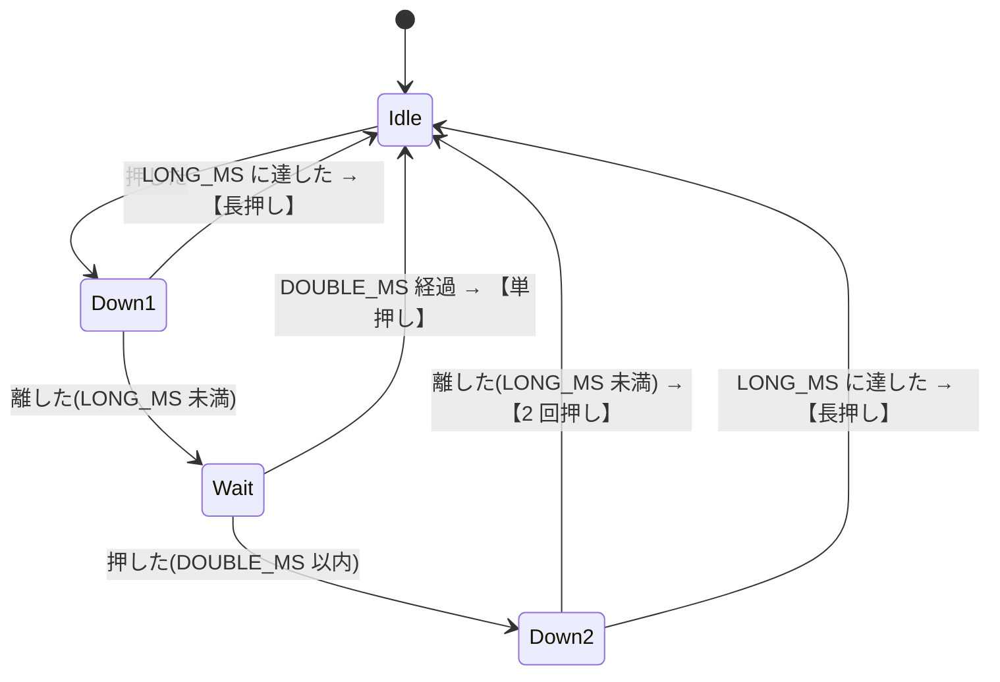

# HALO Button: B 側のボタンの仕様(草案)

- 状態: 草案(コードは含まない。合意後に、B 側の `halo-controller` へ実装する)
- 対象: B 側(左の基板、U1)の CH32V003 に付ける、プッシュボタン 1 つの操作
- 関連: [halo-link-spec.md](halo-link-spec.md)(A 側への命令)、[halo-bridge-spec.md](halo-bridge-spec.md)(ESP32 / Pico W への通知)

## 1. 操作

| 操作 | 動作 |
| --- | --- |
| **単押し** | プリセットを**次へ**切り替える(1 → 2 → 3 → 1 …) |
| **長押し** | **消灯 ⇔ 点灯**を切り替える |
| **2 回押し** | **プリセット 1** にする |

## 2. ハードウェア

| 項目 | 内容 |
| --- | --- |
| ピン | PC4(pin 7)。B 側は LED を付けないので、空いている |
| 回路 | スイッチを、PC4 と GND の間に入れる(KiCad の `SW1`)。**押すと L、離すと H** |
| プルアップ | 内部プルアップ(約 45kΩ)を使う。外付けの抵抗は要らない |
| ノイズ | ソフトウェアでデバウンスする(3 節)。コンデンサは要らない |

## 3. 時間のパラメータ

| 名前 | 既定 | 意味 |
| --- | --- | --- |
| `DEBOUNCE_MS` | 20 ms | 入力が、この時間変わらなければ、確定する |
| `LONG_MS` | 700 ms | 押し続けて、この時間に達したら、長押し |
| `DOUBLE_MS` | 300 ms | 1 回目を離してから、2 回目を押すまでの上限 |

- ボタンの入力は、1 ms ごとにサンプリングする(SysTick か、メインループの 1 ms の刻み)。
- ビルド時に変えられるようにする(`-DHALO_BUTTON_LONG_MS=…` など)。

## 4. 判定の状態遷移



- **長押しは、押している間に LONG_MS に達した時点で動作する**(離すのを待たない)。その後に離しても、何も起きない。
- **単押しは、離してから `DOUBLE_MS` 待って、2 回目が無かったときに確定する**。そのため、単押しの反応は、離してから約 0.3 秒遅れる(8 節の未決事項)。
- 2 回目の押下が `LONG_MS` に達したときは、**長押し**として扱う(2 回押しにはしない)。
- 3 回目以降は、2 回押しが確定したあとの、新しい操作の 1 回目として数える。
- **電源投入時にボタンが押されていたら**、離されるまで無視する。

## 5. 動作の詳細

B 側は、次の値を持つ。

| 値 | 内容 |
| --- | --- |
| `preset_count` | 固定プリセットの数(`halo_new` / `halo_call` で A 側から読む。現状 3) |
| `last_run` | 点灯に戻すときの `halo_run` の番号。初期値 1 |

操作の最初に、**`halo_call` で A 側の状態を読み直す**(`mode`、`preset_id`)。ESP32 / Pico W が先に変えていても、それを前提に動くためである。

| 操作 | 現在の状態 | 実行する `halo_run` | `last_run` |
| --- | --- | --- | --- |
| 単押し | `PRESET`(`preset_id` = *p*) | `halo_run(n)`。*n* = (*p* + 1) % `preset_count` + 1(最後の次は 1 に戻る) | *n* にする |
| 単押し | `AUTO` または `DIRECT` | `halo_run(1)` | 1 にする |
| 単押し | `OFF` | `halo_run(last_run)`(**点灯に戻すだけで、進めない**) | 変えない |
| 長押し | `OFF` | `halo_run(last_run)`(点灯) | 変えない |
| 長押し | `PRESET`(*p*) | `halo_run(0)`(消灯) | *p* + 1 にする |
| 長押し | `AUTO` または `DIRECT` | `halo_run(0)`(消灯) | 変えない(カスタムの番号にはしない) |
| 2 回押し | どれでも | `halo_run(1)` | 1 にする |

- `halo_run(n)` の番号は、`halo-link` の規則(0 = 消灯、1〜`preset_count` = 固定プリセット)。`preset_id` は 0 始まりなので、*n* = `preset_id` + 1。
- 消灯から点灯に戻すとき、点灯するのは、**直前の固定プリセット**。カスタム点灯(`DIRECT`)には戻さない(ESP32 / Pico W が、必要なら、`set.led` と `run` で出し直す)。
- `halo_run` が失敗したとき(`halo.res.ok` が `false`)は、何も変えず、ESP32 / Pico W にも知らせない。もう一度押せば、再び試す。

## 6. 単線の使い方(`halo-bridge` との共存)

B 側の単線は、ESP32 / Pico W の要求を中継する `halo-bridge` と、ボタンの処理の、2 か所が使う。

```text
1. halo_bridge_slave_hold(bridge, true)     … ブリッジの新しい送信を止める
2. halo_bridge_slave_link_busy() が false になるまで、メインループを回す
3. halo_call → halo_run                      … ボタンの処理が、単線を使う
4. halo_bridge_slave_hold(bridge, false)    … ブリッジを再開する
5. halo_bridge_slave_post_event(...)         … 結果を ESP32 / Pico W に知らせる
```

- ESP32 / Pico W の要求が来ていたら(`BUSY`)、その要求は、`hold` が終わってから単線へ出る。ESP32 / Pico W の側から見ると、数十 ms の遅れになる。
- 通信を待つあいだも、I2C の割り込みは動く(I2C は、割り込みで処理する)。

## 7. ESP32 / Pico W への通知

ボタンで変えたあと、`halo_bridge_slave_post_event` を呼ぶ。

| 動作 | 種類 | 引数 |
| --- | --- | --- |
| 単押し、2 回押し | `EVT_PRESET` | `halo_run` の番号(1 以上) |
| 長押しで消灯 | `EVT_OFF` | 0 |
| 長押しで点灯(または、消灯中の単押し) | `EVT_ON` | 点灯したプリセットの番号 |

ESP32 / Pico W は、INT 線(PA2)か、STATUS の `EVENT` ビットで気づき、`EVENT` を読む。詳しい状態は、`halo_call` で読み直す。

## 8. 未決事項

| ID | 内容 | 案 |
| --- | --- | --- |
| K1 | 単押しの反応が、約 0.3 秒遅れる | 受け入れる(2 回押しを見分けるため)。気になるなら、1 回目の押下ですぐ次へ進め、2 回目でプリセット 1 に戻す方式にする(その場合、2 回押しの途中で一瞬、次のプリセットが光る) |
| K2 | 消灯中の単押しは、点灯に戻すだけでよいか | 現案は、戻すだけ。進める方式にもできる |
| K3 | カスタム点灯(`DIRECT`)から消灯して、戻すときの動作 | 現案は、直前の固定プリセットに戻す |
| K4 | 固定プリセットが 4 つ以上の HALO | `preset_count` までを循環する。仕様の変更は不要 |
| K5 | 長押しの時間 `LONG_MS` | 700 ms で始め、実機で調整する |
| K6 | ボタンの操作を、ESP32 / Pico W 側で無効にしたい場合 | v1 では、無し。必要なら、レジスタを足す |
