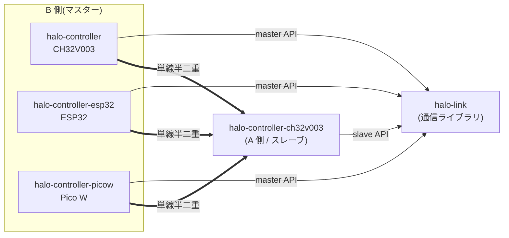
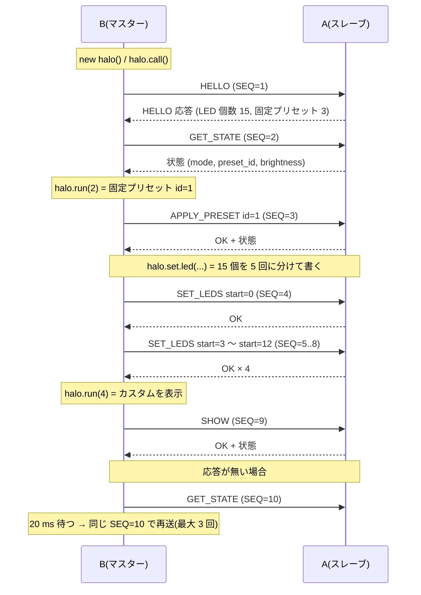

# HALO Link: 単線半二重通信の仕様(草案)

- 状態: 草案(コードは含まない。合意後に実装する)
- 対象: マスター(B 側)とスレーブ(A 側 = CH32V003 の HALO ファームウェア)の間の、GND・電源・信号線 1 本による通信
- 前提(依頼元より):
  - A 側は現在の `halo-controller-ch32v003` をベースにする。**A 側のデータ(variant、固定プリセット)は通信で書き換えない**
  - 通信まわりは、この仕様に完全に合わせる
  - 通信処理はライブラリ(`halo-link`)に切り出し、A 側・B 側で共有する

## 1. 方針

| 項目 | 内容 |
| --- | --- |
| 配線 | 信号 1 本 + GND + 電源の 3 本 |
| 方式 | 単線半二重の UART。マスター(B)が要求し、スレーブ(A)が応答する |
| パケット | 要求・応答とも **16 バイト固定長**。プリセット実行・LED 直接制御・情報要求を同じ形式で扱う |
| スレーブの自発送信 | しない(要求を受けたときだけ応答する) |
| A 側のデータ | 読み出しのみ。通信でフラッシュを書かない(プリセットの書き込み・削除は v1 の対象外) |

[設計メモ](preset-write-methods.md) は 2 線の UART とプリセットの書き込みを前提にしていた。この仕様は、そのうち物理層を単線半二重に変え、フレームを固定長にし、書き込み系コマンドを外したもの。

## 2. 構成



| ディレクトリ | 役割 | 状態 |
| --- | --- | --- |
| `halo-link/` | 通信ライブラリ。フレーム・CRC・マスター/スレーブの処理。MCU に依存しない | 新規 |
| `halo-controller-ch32v003/` | A 側。LED 制御に、スレーブとしての受信・応答を足す | 既存 |
| `halo-controller/` | B 側(CH32V003)。**主**のマスター実装とテスト用ツール | 新規(空ディレクトリは既存) |
| `halo-controller-esp32/` | B 側(ESP32) | 新規 |
| `halo-controller-picow/` | B 側(Pico W) | 新規 |

`halo-controller/` は、これまで「ESP32 / Pico W 側のコントローラ」としていた。B 側を MCU ごとに分けるので、CH32V003 版に割り当て直す(`AGENTS.md` と README の表を更新する)。

## 3. 物理層

### 3.1 回路

信号線は **アイドル時 H** で、各ノードが L に引くことで送信する(ワイヤード AND)。H は外付けのプルアップが作る。
方式は 2 つあり、**CH32V003 同士は PD6 の 1 ピン・オープンドレイン(既定)** を使う。

#### 方式 A: PD6 の 1 ピン・オープンドレイン(CH32V003 同士。既定)

```text
        3V3
         │
       R_PU 10kΩ ───────┐        各ボードに 1 個(2 枚で並列、約 5kΩ)
         │              │
 PD6 ────┤              │  ← クランプ: BAT54 (アノード = PD6、カソード = 3V3)
 (OD)    │              ▼
         │
       R_S 1kΩ
         │
         └──── ジャック Tip ───────────── 相手のボードの Tip
 GND ───────── ジャック Sleeve ──────── 相手のボードの Sleeve
 +5V ──[JP1]── ジャック Ring ──────── 相手のボードの Ring
```

- マイコンは **PD6 だけ**を使う。USART1 をリマップ 2 にして TX を PD6 に移し、半二重モード(`HDSEL`)で送受信する。ピンは **複合機能のオープンドレイン**。
- **プルアップ(約 10kΩ、信号線 → 3.3V)は外付け**。オープンドレインでは内部プルアップが使えず、無いと信号線が H にならない。
- ジャックの Tip(信号)側に **直列抵抗 R_S(1kΩ)** を入れる。抜き差しの一瞬のショートや静電気で、PD6 に流れる電流を減らす。
- PD6 は 5V トレラントではない(データシートで `FT` の記載があるのは PC1・PC2 など。PD6 は `I/O/A`)。**クランプのショットキー(BAT54、PD6 → 3V3)** で、Ring(+5V)に一瞬つながっても 3.3V + 約 0.3V に抑える。
- 電源は A・B とも **3.3V** にそろえる。
- 自分の送信が自分の RX にも返ってくる(エコー)。扱いは 4.3 を参照。

#### 方式 B: ダイオード方式(TX をオープンドレインにできない MCU)

```text
                    3V3
                     │
                   4.7kΩ         プルアップは 1 か所だけ(B 側)
                     │
  B: TX ──[K ▷| A]───┼───[A |◁ K]── A: TX     K = カソード、A = アノード
  B: RX ─────────────┤                         (TX が L のときだけ信号線を L に引く)
  A: RX ─────────────┘   ← 信号線
  GND ─────────────────────────────── GND
```

- Pico W など、TX がプッシュプルしか出せない MCU で使う。TX をダイオードのカソードに、アノードを信号線に接続する。RX は信号線に直接つなぐ。
- ダイオードはショットキー(例: BAT54 相当)。L レベルが約 0.3 V になり、3.3 V 系の VIL を下回る [推測。実機で確認]。
- ESP32 は GPIO をオープンドレインにして UART の TX に割り当てられるはずなので、方式 A に近い形にできる可能性がある [推測。実装時に確認]。

### 3.2 UART 設定

| 項目 | 値 |
| --- | --- |
| 速度 | 115200 bps |
| 形式 | 8N1 |
| 1 バイト | 約 86.8 µs |
| 1 フレーム(16 B) | 約 1.39 ms |

速度は、将来 250000 bps などに上げられるようにする。v1 は 115200 固定とし、実機で足りなければ見直す。

### 3.3 CH32V003J4M6(SOP8)と抜き差しの注意

データシート(CH32V003 Datasheet V1.3、表 2-1 のピン定義)で確認した内容と、それに基づく注意。

| 項目 | 内容 |
| --- | --- |
| ピン | 1: PD6 / PA1(共用)、2: VSS、3: PA2、4: VDD、5: PC1、6: PC2、7: PC4、8: PD1(SWIO) / PD4 / PD5(共用) |
| PD6 のリマップ | 既定は `URX`。リマップ 2(`UTX_2`)で `UTX`(= TX)になる。リマップ 2 は `AFIO_PCFR1` の `USART1_RM1`(bit 21)= 1、`USART1_RM`(bit 2)= 0 |

注意点:

1. **pin 8(SWIO)を GPIO や USART にしない**。pin 8 は PD1(SWIO)・PD4・PD5 が同じピンで、PD5 を TX にすると SWIO を駆動してしまい、書き込みできなくなる(ブリックの恐れ)。通信は PD6 だけを使い、PD4 / PD5 / PD1 のレジスタを触らない。printf デバッグ(`UARTPRINTF`)も PD5 を使うので無効にする。
2. **pin 1 は PD6 と PA1 が共用**。PA1(OSCI)を同時に使わない。外付けクリスタルを付けない。
3. **PD6 は 5V トレラントではない**。Ring を +5V にする場合、抜き差しの一瞬、Tip が Ring に触れて信号が 5V につながる。R_S(1kΩ)とクランプで保護する。
4. **オープンドレインにはプルアップが必須**。2 枚のどちらか(または両方)に付ける。付け忘れると、通信は一切できない。ケーブルが長い・容量が大きい場合は 4.7kΩ に下げる。
5. **LED の DIN は PC6 を使えない**(SOP8 に無い)。引き出されているのは PA2 / PC1 / PC2 / PC4 / PD6 / PD1 だけで、DIN は **PC4**(pin 7)を既定にする。
6. **+5V を Ring で渡すと、2 枚の USB 電源が並列につながる**。両方を USB で給電する場合は、Ring を +5V に接続しない(JP1 を開いたまま)か、片方の USB を外す。電圧差の大きい 2 つの電源をつなぐと、逆流して電源やケーブルに負担がかかる。
7. **抜き差し中は通信が壊れる**。ホットプラグでは、プラグが入る途中で Tip が Sleeve(GND)や Ring(+5V)に触れる。通信中の抜き差しは、`halo-link` のタイムアウトと再送で回復するが、`halo.res.ok` が `false` になる。
8. **電源の順序**。片方だけ給電されている状態で、もう片方の 3.3V が 0V のとき、Tip の信号がクランプのダイオードを通して 3.3V 側に流れ込む。R_S で 3mA 程度に制限されるが、Ring で +5V も渡している場合は、受け側の電源も立ち上がる。
9. **半二重モードの動作は実機で確認する**。`HDSEL` の設定(TX ピンをオープンドレインにして受信と共用する動作)は、STM32 互換の仕様と推測している [推測。リファレンスマニュアルと実機で確認]。
10. **レギュレータ**(XC6206P332MR)は最大 200 mA。CH32V003 だけを 3.3V にする前提で、LED(5V)は 3.3V から取らない。

## 4. フレーム

### 4.1 形式(要求・応答とも 16 バイト)

```text
 byte:  0     1     2     3        4 ... 13       14  15
      ┌─────┬─────┬─────┬────────┬──────────────┬───────────┐
      │ SOF │ SEQ │ CMD │ FLAGS/ │   PAYLOAD    │  CRC16    │
      │     │     │     │ STATUS │  (10 B)      │  (LE)     │
      └─────┴─────┴─────┴────────┴──────────────┴───────────┘
```

| フィールド | サイズ | 内容 |
| --- | --- | --- |
| SOF | 1 | 要求は `0xA5`、応答は `0x5A`。向きを区別し、エコーの除去にも使う |
| SEQ | 1 | マスターが要求ごとに 1 ずつ増やす。応答は同じ値を返す |
| CMD | 1 | コマンド番号。応答は最上位ビットを立てる(例: `0x10` → `0x90`) |
| FLAGS / STATUS | 1 | 要求では FLAGS(v1 は 0)。応答では STATUS(5.3) |
| PAYLOAD | 10 | コマンドごとの内容。使わない部分は `0x00` で埋める |
| CRC16 | 2 | CRC-16/CCITT-FALSE(多項式 `0x1021`、初期値 `0xFFFF`)。byte 1〜13 に対して計算。リトルエンディアン |

多バイトの値は、すべてリトルエンディアン。

### 4.2 コマンドの一覧

| CMD | 名前 | 要求 PAYLOAD | 応答 PAYLOAD | 説明 |
| --- | --- | --- | --- | --- |
| `0x01` | PING | なし | なし | 生存確認 |
| `0x02` | HELLO | なし | 5.1 | プロトコル版・ファーム版・LED 個数など(情報要求) |
| `0x03` | GET_ANGLES | `start`(u8)、`count`(u8、1〜4) | `start`、`count`、偏角(u16)× `count` | LED の偏角を読む(接続順) |
| `0x04` | GET_STATE | なし | `mode`(u8)、`preset_id`(u8)、`brightness`(u8) | 現在の状態 |
| `0x10` | APPLY_PRESET | `id`(u8) | 状態(5.2) | 固定プリセットの再生・消灯・AUTO への復帰(プリセット実行) |
| `0x11` | SET_BRIGHTNESS | `value`(u8) | なし | 全体の明るさ(0〜255)。RAM のみで、保存しない |
| `0x20` | SET_LEDS | `start`(u8)、RGB × 3(FLAGS = 有効な LED の数) | なし | LED を直接指定する(ステージングに書く) |
| `0x21` | FILL | `r`、`g`、`b` | なし | 全 LED を同じ色にする(ステージングに書く) |
| `0x22` | SHOW | なし | 状態(5.2) | ステージングを表示に反映し、直接制御モードにする |
| `0x40`〜`0x4F` | (予約) | | | プリセットの書き込み・削除など、将来用。v1 では `UNSUPPORTED` を返す |

- `APPLY_PRESET` の `id` は、`0`〜(固定プリセット数 - 1)が固定プリセット、`0xFE` は**消灯**(OFF)、`0xFF` は AUTO(現在のデモ動作:固定プリセットを順に表示)に戻す。
- `APPLY_PRESET` と `SHOW` の応答は、実行後の**状態**(5.2)を PAYLOAD に載せる。マスターは、これで状態のキャッシュを更新し、`GET_STATE` を別に送らずに済む。
- `SET_LEDS` は LED を最大 3 個ずつ書く。`start` から RGB を、接続順の番号 `start`, `start+1`, `start+2` に置く。**要求の FLAGS に有効な LED の数(1〜3)を入れる**(`0` は 3 個として扱う)。端数の LED を書くときに、隣の LED を壊さないため。LED 個数を超える分は無視する(15 個なら 5 回で全部を書ける)。
- `SET_LEDS` と `FILL` はステージングを更新するだけで、表示は変わらない。`SHOW` で全 LED が一度に切り替わる。
- 表示色は、全体の明るさ(`SET_BRIGHTNESS`)を掛けた値になる。
- すべてのコマンドは**冪等**。同じ要求を再送しても結果は同じ。

### 4.3 受信の規則

- **スレーブ**(A):
  - SOF `0xA5` を探し、16 バイト集めて CRC を検査する。
  - CRC が合わなければ**何も返さず**、先頭の 1 バイトを捨てて次の SOF 候補から再走査する。
  - バイト間が 2 ms 以上空いたら、途中のフレームを捨てる。
  - SOF `0x5A` のバイト(自分の応答のエコー)は捨てる。
- **マスター**(B):
  - 送信後、SOF `0xA5` のバイト(自分の要求のエコー)を捨て、SOF `0x5A` から 16 バイトを受ける。
  - 応答の SEQ が要求と一致しなければ捨てる(遅れて届いた古い応答など)。
- **A の受信が LED の送信で欠けない**ようにする。SK6812 のビットバング中は割り込みを止める(15 個で約 0.5 ms = 約 6 バイト分)。USART の受信レジスタは 1 バイトしかないので、割り込みだけでは取りこぼす。A は USART を **DMA の循環バッファ**で受け、LED の送信後にまとめて解析する。受信バッファは 64 バイト以上 [案]。

### 4.4 タイミング

| 項目 | 値 | 備考 |
| --- | --- | --- |
| A の応答開始 | 要求の最終バイトから **10 ms 以内** | LED の送信中は、その終了後に応答する |
| B の応答待ち | **20 ms** | 超えたら再送 |
| B の再送 | 同じ SEQ で最大 3 回(合計 4 回) | それでも駄目なら呼び出し元にエラーを返す |
| B の送信間隔 | 前の応答の最終バイトから **1 ms 以上** | バスを空ける |
| 要求と応答の往復 | 約 3 ms(転送のみ) | 5 回の `SET_LEDS` + `SHOW` で 20 ms 前後 |

マスターは、要求を 1 つずつ送る(応答を受けるまで次を送らない)。そのため、バス上で衝突は起きない。

## 5. 応答の内容

### 5.1 HELLO の応答 PAYLOAD

| byte | 内容 |
| --- | --- |
| 0 | プロトコル版(v1 = `1`) |
| 1〜3 | ファーム版(major, minor, patch) |
| 4〜5 | LED 個数(u16) |
| 6 | 固定プリセット数 |
| 7 | variant の識別子(u8)。`0` は未設定 |
| 8〜9 | 予約(`0`) |

マスターは、接続後に最初に HELLO を送る。プロトコル版が自分の知るものより新しければ、対応できないと判断する。LED 個数は、`SET_LEDS` の回数の計算に使う。

### 5.2 GET_STATE の応答 PAYLOAD

| byte | 内容 |
| --- | --- |
| 0 | `mode`: `0` = AUTO(デモ動作)、`1` = PRESET、`2` = DIRECT(直接制御)、`3` = OFF(消灯) |
| 1 | `preset_id`: PRESET のときの ID |
| 2 | `brightness`: 全体の明るさ |

### 5.3 STATUS

| 値 | 名前 | 意味 |
| --- | --- | --- |
| `0x00` | OK | 成功 |
| `0x01` | BAD_CMD | 未知のコマンド |
| `0x02` | BAD_ARG | 範囲外の ID や値 |
| `0x03` | BUSY | 処理中(再送すればよい) |
| `0x04` | UNSUPPORTED | 予約したコマンド(v1 では未対応) |
| `0x05` | INTERNAL | 内部エラー |

CRC が合わない要求には、**応答しない**(LEN などを信用できないため)。マスターのタイムアウトと再送で回復する。

## 6. シーケンスの例



## 7. ライブラリ `halo-link`

- 純粋な C(C99)。動的メモリ確保なし、グローバル状態なし
- MCU 依存の部分は、ポート(関数ポインタの組)に切り出す
- A 側(スレーブ)と B 側(マスター)で同じフレーム処理・CRC を使う
- ホスト(PC)でのユニットテストを持つ(CRC、フレームの組立・解析、再走査、マスター/スレーブの結合)

```text
halo-link/
├── include/
│   ├── halo_link.h          公開 API(フレーム、コマンド、マスター、スレーブ)
│   └── halo_link_port.h     MCU 依存のポート
├── src/
│   ├── halo_link_frame.c    組立・解析・CRC(MCU 非依存)
│   ├── halo_link_master.c   要求の送信・応答待ち・再送
│   └── halo_link_slave.c    受信・解析・ハンドラの呼び出し
├── tests/                   ホストでのテスト
└── README.md
```

### 7.0 マスター側の使い方(`halo` オブジェクト)

B 側のアプリは、フレームやコマンドを意識せず、`halo` オブジェクトを通して A を操作する。

```text
halo = new halo()          // 生成時に call() を 1 回行う(接続確認と状態の取得)
if !halo.res.ok            // 直近の API 呼び出しが成功したか。API を呼ぶたびに更新される
  return
[count, preset] = halo.res.status   // 保持している状態(API は呼ばない)。更新は halo.call()
halo.set.led(args)         // カスタム点灯を設定する(表示はまだ変わらない)。戻り値は ok
halo.run(int)              // 点灯を実行し、状態も更新する。戻り値は ok
halo.call()                // 状態を更新する。戻り値は ok
```

| 呼び出し | 通信 | 内容 |
| --- | --- | --- |
| `new halo()` | `HELLO` + `GET_STATE` | 接続確認。LED 個数・固定プリセット数・版・現在の状態を取得 |
| `halo.call()` | `HELLO` + `GET_STATE` | 状態の更新。`res.status` を作り直す |
| `halo.set.led(args)` | `SET_LEDS` / `FILL` を必要な回数 | カスタム点灯を A のステージングに書く。3 個ずつの分割はライブラリが行う |
| `halo.run(0)` | `APPLY_PRESET` `0xFE` | **none**: 消灯 |
| `halo.run(1〜3)` | `APPLY_PRESET` `n - 1` | 固定プリセット(1 始まり。上限は `count` ではなく固定プリセット数) |
| `halo.run(4)` | `SHOW` | **custom**: `set.led` で書いたカスタム点灯を表示する |
| `halo.run(5〜)` | (送らない) | 予約。`BAD_ARG` 相当のエラーを返す |

- `halo.res`: 直近の API 呼び出しの結果(7.0.1)。
- `halo.run(int)`: `0` = none(消灯)、`1〜3` = 固定プリセット、`4〜` = custom。固定プリセットの数が 3 でない HALO は、`1〜preset` が固定プリセットになり、`preset + 1` 以降が custom になる。**上の表の `4` は、固定プリセットが 3 つのときの値**。
- `run` の応答は状態を含むので、成功した `run` の後に `halo.res.status` を読めば、A 側の状態に合っている。
- `halo.set.led(args)` の `args`(案):
  - `set.led(index, color)`: 1 個
  - `set.led(colors[], n)`: 先頭から `n` 個
  - `set.led(start, colors[], n)`: `start` から `n` 個
  - `set.fill(color)`: 全部同じ色
- カスタム点灯を更新するときは、`set.led` で書き、`run(4)` で一度に反映する(途中の状態は見えない)。直接制御中でも同じ。LED が 15 個なら、書き込み 5 回 + 反映 1 回で 20 ms 前後。

#### 7.0.1 `halo.res`

```text
halo.res
├── ok      : bool    直近の API 呼び出しが成功したか
├── error   : 失敗の理由(ok のときは kind = NONE)
│   ├── kind          NONE / TIMEOUT / DEVICE_STATUS / BAD_ARG / NOT_READY / VERSION
│   ├── device_status A が返した STATUS の値(kind = DEVICE_STATUS のとき)
│   └── index         失敗した位置(set.led で、最初に失敗した LED の番号)
└── status  : A の状態のキャッシュ(API は呼ばない)
    ├── led_count, preset_count         … [count, preset] の 2 つ
    ├── proto_ver, fw_version[3]
    ├── mode, preset_id, brightness
    ├── valid   : bool    1 度でも HELLO / GET_STATE に成功したか
    ├── fresh   : bool    最新の状態か(下記)
    └── age_ms  : u32     状態を最後に更新してからの経過時間
```

規則:

- **`ok` と `error` は、API を 1 回呼ぶたびに上書きする**(`new` / `call` / `set.*` / `run`)。前の呼び出しの結果は残らないので、各呼び出しの直後に確認する。
- **各 API は `ok`(bool)を返す**。`if !halo.run(1) return` のように使えるし、`halo.res` をあとでまとめて見てもよい。
- **`status` が更新されるのは、状態を載せた応答に成功したとき**だけ(`HELLO` / `GET_STATE` / `APPLY_PRESET` / `SHOW`)。`set.led` は更新しない。
- **失敗しても `status` の値は消さない**。代わりに `fresh = false` にする。`fresh` が `true` に戻るのは、次に `call()` か `run()` が成功したとき。
  - `led_count` や `preset_count` など、HALO ごとに固定の値は、`fresh` が `false` でも使える(`valid` が `true` なら)。
  - `mode` や `preset_id` など、変わる値は、`fresh` が `true` のときだけ信用する。
- `valid = false`(`new halo()` の最初の接続が失敗した直後など)のとき、`count` と `preset` は `0` になる。この状態で `call()` 以外の API を呼ぶと、通信せずに `kind = NOT_READY` で失敗する。
- `error.kind`:

| kind | 意味 |
| --- | --- |
| `NONE` | 成功 |
| `TIMEOUT` | 再送(最大 3 回)しても、有効な応答が来なかった |
| `DEVICE_STATUS` | A が `OK` 以外の STATUS を返した(値は `device_status`) |
| `BAD_ARG` | 引数が範囲外。**通信せずに**失敗する(例: `run(5)`、`run(1〜)` が固定プリセット数を超える、LED の番号が範囲外) |
| `NOT_READY` | 接続できていない(`valid = false`) |
| `VERSION` | A のプロトコル版が、このライブラリの対応する版より新しい |

- **複数回の通信になる API(`set.led`)は、最初の失敗で中断する**。`ok = false`、`error.index` に失敗した位置(その通信の先頭の LED 番号)を入れ、残りは送らない。A のステージングは途中まで書き換わっているが、`run(4)` を呼ぶまで表示は変わらないので、画面は乱れない。復旧は、`set.led` を最初からやり直してから `run(4)` を呼ぶ。
- 再送の回数や往復時間などの診断情報は、v1 では持たない。
- `halo` オブジェクトは単一のスレッド(または単一のメインループ)から使う。割り込みハンドラや複数のタスクから同時に呼ばない。

C での形(C99。CH32V003 を含む全 B 側で使う):

```c
halo_t halo;
halo_new(&halo, &port);                       // = new halo()(戻り値は ok)
if (!halo.res.ok) return;
uint16_t count  = halo.res.status.led_count;  // [count, preset]
uint8_t  preset = halo.res.status.preset_count;
halo_set_led(&halo, 0, colors, 15);           // = halo.set.led(...)
halo_run(&halo, 4);                           // = halo.run(4)
halo_call(&halo);                             // = halo.call()
```

ESP32 / Pico W(C++)向けには、`halo.set.led(...)` / `halo.run(...)` と同じ書き方のできる薄い C++ ラッパー(`halo_link.hpp`)を、必要なら足す。

### 7.2 ポートとスレーブの API(案)

```c
// ポート: 実装は MCU ごとの B 側ディレクトリ・A 側に置く
typedef struct {
    size_t   (*write)(void *ctx, const uint8_t *buf, size_t len);   // 送信
    size_t   (*read)(void *ctx, uint8_t *buf, size_t max);          // 受信済みを取り出す(非ブロック)
    uint32_t (*now_us)(void *ctx);                                  // 単調増加の時刻[µs]
    void      *ctx;
} halo_link_port_t;

// スレーブ(A): 受信したコマンドごとにハンドラを呼ぶ
typedef struct {
    halo_link_status_t (*apply_preset)(void *ctx, uint8_t id);
    halo_link_status_t (*set_leds)(void *ctx, uint8_t start, const halo_rgb3_t *rgb);
    halo_link_status_t (*show)(void *ctx);
    /* ... */
} halo_link_slave_ops_t;
void halo_link_slave_poll(halo_link_slave_t *s);
```

### 7.3 依存の扱い(CI への影響)

`halo-link` を使う各ディレクトリは、ビルド時に `../halo-link` のソースを取り込む(同じリポジトリ内の相対パス)。**`halo-link` が変更されたら、それを使うディレクトリも再ビルドする**必要がある。

現在の CI は、変更のあったディレクトリだけをビルドする。そのため、次の変更が必要になる。

- 各ビルド対象ディレクトリに、依存する他ディレクトリを書いたファイル(例: `halo-<name>/deps.txt`)を置く
- `scripts/changed-dirs.sh` が、変更されたディレクトリに依存するディレクトリも対象に含める

疎結合の方針(デバイス間でソースを直接参照しない)との関係:

- デバイスのディレクトリ同士は、引き続き**互いを参照しない**
- 共有してよいのは `halo-link` だけで、これは「契約(この仕様)の実装」という位置づけ
- 仕様(この文書)を変えるときは、`halo-link` と各デバイスを合わせて更新する

## 8. A 側(`halo-controller-ch32v003`)の変更範囲

- 追加: スレーブとしての受信・応答(USART1 + DMA、`halo-link` のスレーブ API の呼び出し)
- 追加: 表示の状態(AUTO / PRESET / DIRECT)、ステージングバッファ、全体の明るさ
- **変更しない**: variant、固定プリセット、`halo_preset_t` の形式、SK6812 ドライバ
- 起動時は AUTO(現在と同じデモ動作)。通信が無くても今までどおり動く
- ピンは **PD6 の 1 ピンだけ**(USART1 リマップ 2 で TX を PD6 にし、半二重モード、オープンドレイン。データシートで確認済み)。PD5 は触らない(3.3 の注意点 1)。ch32fun の printf デバッグ(`UARTPRINTF`)は PD5 を使うので、通信を有効にするときはデバッグ出力を無効にする。LED の DIN は PC4

## 9. 実装タスクの分割案

| 順 | ディレクトリ | 内容 | scope(PR の label) |
| --- | --- | --- | --- |
| 1 | `halo-link` | フレーム・CRC・マスター/スレーブ + ホストのテスト | `link` |
| 2 | `halo-controller-ch32v003` | スレーブの組み込み(USART + DMA)、状態管理 | `controller-ch32v003` |
| 3 | `halo-controller` | B 側(CH32V003)。A に HELLO → プリセット実行 → 直接制御を送るテスト用ツール。**ここで実機の疎通を確認する** | `controller` |
| 4 | `halo-controller-esp32` | B 側(ESP32)。ポートの実装 | `controller-esp32` |
| 5 | `halo-controller-picow` | B 側(Pico W)。ポートの実装 | `controller-picow` |
| 6 | リポジトリ共通 | CI の依存解決(7.3)、`AGENTS.md` と README の更新 | `repo` |

1 と 6 は、2 以降の前提になる。2 と 3 は並行して進められるが、疎通の確認は両方が揃ってから行う。

## 10. 未決事項

| ID | 内容 | 案 |
| --- | --- | --- |
| U1 | 通信が途切れたときの動作(直接制御のまま光り続ける) | v1 は最後の状態を保持。必要ならウォッチドッグ(一定時間フレームが無ければ AUTO に戻す)を追加する |
| U2 | 速度 | 115200 bps で始め、足りなければ 250000 bps 以上に上げる |
| U3 | variant の識別子(HELLO の byte 7) | 当面は `0`。複数の HALO を区別する必要が出たら定義する |
| U4 | 偏角の読み出し(GET_ANGLES)の要否 | LED 個数が多い HALO で使う。B 側が偏角を知る必要が無ければ省略できる |
| U5 | 回路の実機確認 | 方式 A の L レベル・立ち上がり(R_PU 10kΩ + R_S 1kΩ で 115200 bps が出るか)。方式 B(ダイオード)も同様 |
| U6(解決) | CH32V003 の USART の `HDSEL` で、ダイオード無しの 1 ピン構成にするか | PD6 の 1 ピン・オープンドレインを既定に採用(3.1 方式 A)。`HDSEL` の動作は実機で確認する |
| U7 | プリセットの書き込み(予約コマンド `0x40`〜) | v1 の対象外。必要になったら設計メモ(`preset-write-methods.md`)を土台に別途仕様化する |
| U8(解決) | `halo.run(0)` の none を「消灯」とし、`run(4〜)` の custom を「`set.led` で書いた表示(4 のみ)」とした解釈 | 5 以降を、B 側が持つ複数のカスタムに割り当てるなら、ライブラリ側で `set.led` の保存先を分ける(A の通信は変えない)。**この解釈で確定** |
