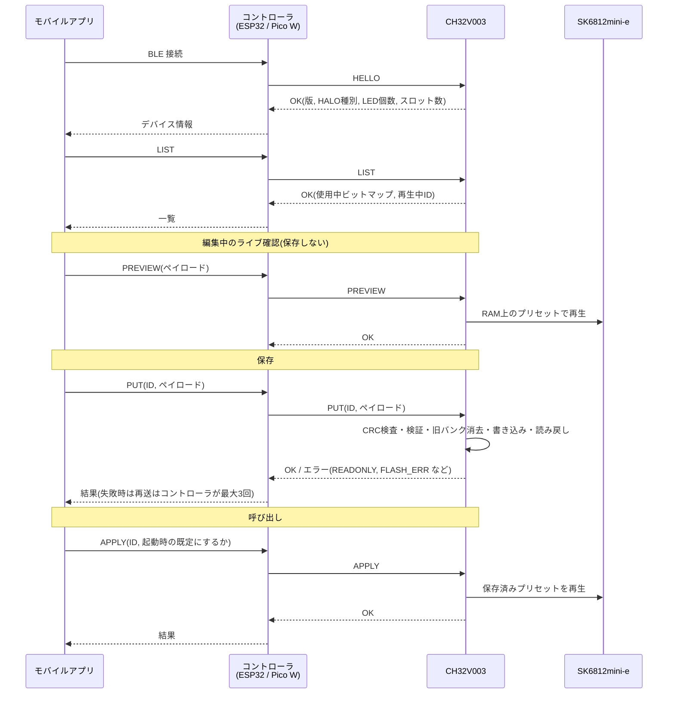

# プリセット書き込み・呼び出し方式の検討(設計メモ)

- 状態: 草案(実装前の設計メモ。コードは含まない)
- 対象: ESP32 / Raspberry Pi Pico W(以下「コントローラ」)から CH32V003(以下「V003」)へ、ライティングのプリセットを書き込み・呼び出しする方法
- 前提(依頼元より):
  - 構成は モバイル端末 ⇔(BLE)⇔ コントローラ ⇔(有線)⇔ V003 ⇒ SK6812mini-e
  - 固定プリセット3種は変更不可で、V003 のファームに埋め込む
  - LED 個数と各 LED の偏角は HALO の種類ごとの固定情報で、V003 側が保持する

## 凡例(根拠の確度)

本書の数値・事実には確度を付ける。

- **[確認]** 公式資料または一次情報で確認できたもの
- **[二次]** 公式ではない資料(フォーラム、他者の実装、解説)で見たもの。実装前に公式資料で裏取りする
- **[推測]** 筆者の推測。根拠が無いか弱い
- **[要確認]** 調査で確認できなかったもの。決定を左右するので実機または公式資料で確認が必要

出典は末尾の「出典」に番号で挙げ、本文では `[S1]` のように参照する。

---

## 1. CH32V003 の仕様(判断材料)

| 項目 | 内容 | 確度 / 出典 |
| --- | --- | --- |
| コード用フラッシュ | 16 KB(0x08000000〜) | [確認] [S1][S2] |
| SRAM | 2 KB(0x20000000〜)、バイト/ハーフワード/ワードアクセス可 | [確認] [S1][S2] |
| システムフラッシュ(ブートローダ領域) | 1920 B。工場出荷のブートローダが入る。ユーザーのチップ消去では消えない | [確認] 容量 [S1][S2]。消えない点は [二次] [S6] |
| オプションバイト / システム設定 | 各 64 B | [二次] [S1] の抜粋 |
| フラッシュ制御 | KEYR / MODEKEYR のキー解除。標準プログラム(PG)と高速プログラム(ページ消去 FTER・バッファ BUFRST/BUFLD) | [二次] [S3][S4] |
| 高速モードの単位 | **64 B ページ**で消去・書き込み。手順は「ページ消去 → バッファクリア → バッファへワード書き込み → ページ書き込み」 | [二次] [S3][S4]。公式 SDK が高速モードを実装していないという指摘もある [S3] |
| 1 KB セクタ消去 | あるという情報を見たが確認できていない。本設計は 64 B ページのみを前提にする | [要確認] |
| 書き換え回数(耐久性) | 資料からは数値を取得できなかった。**本書は 1 万回/ページを仮定**して設計する(保存先の分散とA/B交互書き込みで余裕を持たせる) | [要確認]/仮定 [S1][S5] |
| データ保持 | データシートに 10 年の記載があるという報告。条件は不明 | [二次] [S5] |
| 自己書き換え中の CPU | フラッシュ書き込み中にフラッシュから実行を続けられるか確認できなかった。一般にセクタ型フラッシュは RAM 上のコードから書く | [要確認] 一般論 [S6] |
| デバッグ I/F | SWIO(1線)、ピン PD1 | [二次] [S7][S8] |
| UART(USART1)の標準ピン | TX = PD5、RX = PD6 | [二次] [S9][S10] |
| 動作電圧 | 3.3 V と 5 V の両方で使える製品として扱われる | [推測]。データシートで範囲を確認する |
| SWIO の外部書き込み | ESP32 / Pico 上の自作書き込み機の実例が複数ある。ビットバンギングはタイミングがシビアで、Pico は PIO、ESP32 は RMT を使う例が多い | [二次] [S7][S8][S11][S12][S13] |

注意すべき帰結:

1. 書き込み単位が 64 B ページなので、プリセット1件を「1ページ(64 B)以内」に収めると、1件の更新が1ページの消去+書き込みで済み、他のデータに影響しない。
2. SRAM が 2 KB しかない。ファーム全体の書き換え(方式 A)は、コントローラ側が V003 のイメージ(最大 16 KB)を保持して流し込む必要がある。
3. 耐久性の数値が未確認なので、頻繁な書き換えを前提にしない設計(RAM への一時適用を併用)にする。

---

## 2. 方式の比較

### 2.1 検討した方式

- **(A) SWIO 書き込み**: コントローラが V003 の SWIO(PD1)をビットバンギング(または PIO/RMT)して、フラッシュを直接書く。ファーム全体を書き直す案(A1)と、プリセット領域だけを書き換える案(A2)がある。
- **(B) 実行中コマンド方式**: V003 が動作している状態で、UART で コマンドを送る。V003 のファームが自分のフラッシュ(保存用の領域)にプリセットを保存する。
- **(C) ブートローダ(ISP)方式**: V003 の工場出荷ブートローダ(システムフラッシュ 1920 B)経由で書く。または自作ブートローダを置く。
- **(D) I2C 方式**: (B) の通信路を I2C(V003 がスレーブ)にしたもの。保存は (B) と同じ。
- **(E) 外付け不揮発メモリ方式**: I2C EEPROM / FRAM などを置き、V003 が読む。
- **(F) コントローラ保持・RAM 配信方式**: ユーザープリセットはコントローラの不揮発メモリ(ESP32 の NVS、Pico W の flash)に持つ。V003 には起動のたびに RAM へ配信する。V003 のフラッシュにはユーザープリセットを一切書かない。

(B) と (D) は保存方法が同じなので、通信路だけが違う。以下では UART を前提にして (B) と書く。

### 2.2 比較表

評価: ◎ 良い / ○ 可 / △ 難あり / × 不可・不向き

| 観点 | A1 SWIO 全書き | A2 SWIO 領域書き | B UART コマンド | C ブートローダ | E 外付けメモリ | F コントローラ保持 |
| --- | --- | --- | --- | --- | --- | --- |
| 実現性 | ○ 実例あり [S7][S8][S11][S12] | ○ 同左 + デバッグ I/F でのフラッシュ書き込みが必要 | ◎ 一般的な構成。フラッシュの自己書き換えは [二次] の情報でページ単位(64 B)と読める | △ 工場ブートローダの手順が未確認。自作は 1920 B に収める必要 [S6][S14] | ○ 部品を足せば可 | ◎ V003 側は RAM 受信だけ |
| 配線(V003 周り) | SWIO + GND + 電源(+NRST 任意)= 3〜4 | 同左 | **UART 2 本 + GND + 電源 = 4**(NRST と SWIO は任意) | UART 2 本 + BOOT 条件(ピン操作が必要な場合あり。[要確認])+ GND + 電源 | I2C 2 本 + 電源 | B と同じ |
| 書き込める範囲 | 全領域(固定プリセットも書ける) | 指定領域 | ファームが許した領域のみ | 全領域 | 外付け側 | RAM のみ(再起動で消える) |
| 固定3種を壊さない保証 | × 書き込み側が全領域を書けるので、誤書き込みで壊れる | △ 書き込み側のバグ次第 | ◎ V003 のファームが書き込み先アドレスを保存領域に限定する(通信から任意アドレスを指定できない) | × 全領域を書けるのが目的 | ◎ そもそも別メモリ | ◎ フラッシュに触れない |
| 失敗時の復旧 | 途中で失敗すると V003 が起動しない。ただし SWIO から再書き込みで復旧 | 同左(領域が壊れても起動はする) | 保存領域が壊れても、CRC 検査で検出して固定プリセットで起動。再書き込みで復旧 | 失敗でブートローダが壊れると SWIO が必要 | EEPROM 不良時は固定で起動 | 配信失敗時は固定プリセットで起動 |
| 実装コスト | 大。コントローラごとに SWIO 実装 + 16 KB のイメージ保持 + 書き込み検証。ESP32 と Pico で別実装(RMT / PIO)になりがち | 大。A1 + 領域管理 | **中**。V003 にコマンドパーサと保存処理、コントローラは UART 送受信だけ | 大。ブートローダの設計と配布 | 中〜大(部品追加) | **小** |
| ESP32 / Pico W 両対応 | △ 精度の高い波形生成が必要で、チップごとに別実装 [S11][S12][S13] | △ 同左 | ◎ どちらも UART があり、同じプロトコルで揃う | ○ | ○ | ◎ |
| 書き込み時の V003 動作 | 停止(書き込み中は LED 制御不可) | 同左 | 動作中のまま可。書き込み中の数 ms だけ表示が乱れる可能性([要確認]) | 停止 | 動作中のまま | 動作中のまま |
| 摩耗 | ファーム全体を消す。頻度が低い用途向き | プリセット領域のみ | 保存領域のみ。A/B で分散 | 同左 | EEPROM(大容量・高耐久) | V003 は無摩耗 |
| 単独動作(コントローラ無し) | ○ | ○ | ○ 保存したプリセットで起動 | ○ | ○ | × コントローラが無いと固定3種のみ |

### 2.3 評価の補足

- **A はプリセット書き込みの用途に向かない。** 全領域を書ける手段をユーザー操作(スマホ → BLE)の経路に載せると、固定プリセットを壊さない保証が作りにくい。一方、ファームの更新手段としては有用なので、**補助(開発・復旧用)として残す**。
- **C(工場ブートローダ)** は、UART で書けるらしいという情報はあるが、起動条件・プロトコルを一次資料で確認できていない [要確認]。確認できても、プリセット更新のたびにアプリ全体と一緒に書く形になる。自作ブートローダの例 [S14] はあるが、1920 B に収める難度が高い [S6]。
- **E** は V003 のフラッシュ容量不足が問題になった場合の逃げ道。プリセット数が少ない(下記)ので現時点では不要。
- **F** は摩耗・保証の面で最も安全。ただし「コントローラ無しでも V003 が保存プリセットを再生できる」ことが要件かどうかで評価が変わる([未決事項 U1])。**B を採用しつつ、B のプロトコルに RAM 即時適用(PREVIEW)を入れることで、F の運用(起動時にコントローラが毎回送る)にも切り替えられる**ようにする。

---

## 3. 推奨方式

### 3.1 結論

**(B) UART コマンド方式を主とする。** V003 のファームが、UART で受けたプリセットを、自分のフラッシュ末尾の専用領域に 64 B ページ単位で保存する。併せて、**SWIO(PD1)は書き込み・デバッグ用に必ず引き出す(コネクタ/パッド)**。SWIO を使ったファーム全体の書き込み(A)は、開発時と工場書き込み、およびフィールドでの復旧に使う。

### 3.2 理由

1. **固定プリセットを壊さない保証が作れる。** 書き込みアドレスを V003 のファームが決め、通信側からはスロット番号(ID)しか指定できない。固定プリセット ID(0〜2)に対する書き込み・削除は NACK(READONLY)にする。
2. **コントローラの実装が揃う。** ESP32 と Pico W のどちらも UART を持つので、同じ仕様でコーディングできる。方式 A はタイミング制御(RMT / PIO)がチップごとに別実装になる [S11][S12][S13]。
3. **配線が少ない。** UART 2 本 + GND + 電源の4本で済む。
4. **失敗しても復旧できる。** 保存領域は CRC で検査し、壊れていれば固定プリセットで起動する。最悪でも SWIO から書き直せる。
5. **疎結合を保てる。** コントローラは V003 の内部メモリ構造を知らなくてよい。契約は「UART フレーム仕様」と「プリセットのデータ形式」だけ。
6. 実装コストが中程度。V003 側にコマンドパーサと保存処理が必要だが、ブートローダ(C)や外付けメモリ(E)より小さい。

### 3.3 採用しない理由

| 方式 | 理由 |
| --- | --- |
| A1 / A2 | 固定プリセットを壊さない保証が弱く、ESP32 / Pico でタイミング制御が別実装になる。補助用途にとどめる |
| C | 起動条件・プロトコルが未確認。確認できても全体書き換えになる |
| D | UART でも足りるため。I2C が必要になったときは通信路だけ差し替える(フレームは共通にできる) |
| E | 容量が足りる限り部品追加が不要 |
| F | 単独動作が要件なら不可。ただし併用できる設計にしてある |

---

## 4. 推奨方式の詳細仕様

### 4.1 配線と電圧レベル

```
        コントローラ (ESP32 / Pico W)              CH32V003
        ┌───────────────────────┐          ┌────────────────────────┐
        │ UART TX  ─────────────┼─────────▶│ PD6 (USART1 RX)        │
        │ UART RX  ◀────────────┼──────────│ PD5 (USART1 TX)        │
        │ GPIO(任意) ───────────┼─────────▶│ NRST                    │
        │ GND ──────────────────┼──────────│ GND                    │
        │ 3V3 ──────────────────┼─────────▶│ VDD (※下記の電源方針)  │
        └───────────────────────┘          │ PD1 (SWIO) ─▶ 書き込みコネクタ │
                                           │ 出力ピン ─▶ (バッファ) ─▶ SK6812 DIN │
                                           └────────────────────────┘
```

| 信号 | V003 ピン | 備考 |
| --- | --- | --- |
| UART RX(コントローラ TX から) | PD6 | [二次] [S9][S10]。V003 のピン割り当ては最終的にデータシートで確認 |
| UART TX(コントローラ RX へ) | PD5 | 同上。ch32fun の printf デバッグも PD5 を使う点に注意 [S9] |
| SWIO | PD1 | [二次] [S7][S8]。**UART や LED に転用しない**。ファームがこのピンを GPIO にすると書き込みできなくなる恐れがあるため |
| NRST | NRST(PD7 と共有) | 任意。コントローラから V003 をリセットできると、固まったときに復旧できる [推測] |
| 電源 / GND | VDD / VSS | 共通 GND は必須 |

電圧レベル:

- ESP32 と Pico W の GPIO は 3.3 V で、5 V 入力は許容されない [推測。各データシートで確認]。V003 を 5 V で動かすと、V003 の TX(PD5)が 5 V 出力になり、コントローラの RX を壊す恐れがある。
- SK6812mini-e は一般に 5 V 駆動で、データ入力の H しきい値が電源の 0.7 倍程度(5 V なら 3.5 V 付近)とされる。3.3 V 出力を直結すると不安定になる恐れがある [推測。SK6812mini-e のデータシートで確認]。
- **方針案**: V003 は コントローラと同じ **3.3 V** で動かし、UART はレベル変換なしで直結する。LED の DIN は 5 V 系のバッファ(74AHCT125 など)でレベル変換する。V003 を 5 V にする場合は UART 線にレベル変換(または抵抗分割)を入れる。どちらにするかは基板設計側の判断([未決事項 U2])。
- UART 線には直列抵抗(例: 100〜330 Ω)を入れて、SWIO 書き込み中などの競合に備える [推測]。
- SWIO ラインにはプルアップが必要な実装が多い(例: 1 kΩ〜10 kΩ)[S7][S8]。書き込み機を接続したときだけ付ける形にするか、基板に常設するかを決める。

### 4.2 フラッシュのレイアウト案

16 KB(256 ページ × 64 B)を、リンカスクリプトで次のように分ける。**アドレスは案**であり、V003 側のファームサイズが確定したら調整する。

| 領域 | オフセット案 | サイズ | 内容 | 書き換え |
| --- | --- | --- | --- | --- |
| アプリ(ファーム本体 + 固定プリセット3種 + LED 偏角テーブル) | 0x0000〜0x37FF | 14 KB | コード、定数。固定プリセットは `const` として埋め込む | SWIO(A)のみ |
| 設定領域 | 0x3800〜0x38FF | 256 B(4 ページ) | 起動時のプリセット ID、グローバル輝度など。A/B 交互 | UART(B) |
| ユーザープリセット領域 | 0x3900〜0x3EFF | 1536 B(24 ページ) | 8 スロット × 2 バンク(A/B)× 64 B = 1024 B + 余裕 512 B | UART(B) |
| 予備 | 0x3F00〜0x3FFF | 256 B | 将来の拡張 | — |

- アプリ領域が 14 KB と大きいのは、V003 側の実装サイズが分からないための余裕。確定したらユーザー領域を増やせる。
- ファーム(アプリ領域)は UART から**絶対に書き換えない**。フラッシュ書き込み関数は、「設定領域」と「ユーザープリセット領域」の範囲内の64 B境界アドレスしか受け付けない(範囲外は書かずにエラー)。これが「固定プリセットを壊さない保証」の根拠になる。
- 各スロットは 64 B の**レコード**1つで、A/B 2バンクを持つ。更新は「古い方のバンクを消去して書く」。新しい書き込みが完了するまで旧データが有効なので、書き込み中の電源断でも旧データが残る。
- 書き換え回数: 1 スロットを毎回同じバンクに書くと耐久が半分になるが、A/B 交互なので 1 スロットあたりの実効上限は 1 バンクの上限の約 2 倍になる。1 万回/ページの仮定なら 1 スロット約 2 万回で、人の操作では十分 [仮定]。耐久性の数値を確認する([未決事項 U3])。

レコード形式(1バンク = 64 B):

| オフセット | サイズ | 内容 |
| --- | --- | --- |
| 0 | 1 | 有効マーカ(0xA5。消去状態 0xFF と区別する) |
| 1 | 2 | 世代番号(seq, u16 LE。大きい方が新しい。0xFFFF は無効) |
| 3 | 1 | スロット番号 |
| 4 | 58 | プリセットペイロード(4.4)。使わない部分は 0 |
| 62 | 2 | CRC-16(オフセット 0〜61 に対して) |

起動時: 全スロットの A/B を読み、マーカと CRC が正しく seq が最大のものを採用する。どちらも不正なら そのスロットは「空き」とする。起動時のプリセット ID が空きスロットを指す、または設定領域が不正な場合は、固定プリセット 0 で起動する。

### 4.3 通信プロトコル案

#### 物理層

- UART 8N1、**115200 bps**(案)。V003 の USART は より高速にもできる [推測]。プリセット1件(最大 約 70 B)の送信は 115200 bps で約 6 ms。速度を上げる必要は無い。
- フロー制御なし。V003 は RAM 受信バッファ(128 B 程度)を 割り込み/DMA で受ける。
- コントローラが主(マスター)、V003 が従(スレーブ)。**V003 は要求を受けたときだけ応答する**(自発送信しない)ので、1 対 1 のリクエスト/レスポンスになる。

#### フレーム形式

```
リクエスト : [0xA5][LEN][SEQ][CMD][PAYLOAD ... ][CRC16 LE]
レスポンス : [0xA5][LEN][SEQ][CMD|0x80][STATUS][DATA ...][CRC16 LE]
```

| フィールド | サイズ | 内容 |
| --- | --- | --- |
| SOF | 1 | 0xA5 固定 |
| LEN | 1 | CMD 以降 CRC 前までのバイト数(最大 72) |
| SEQ | 1 | リクエストごとにコントローラが増やす番号。レスポンスは同じ値を返す |
| CMD | 1 | コマンド番号。レスポンスは最上位ビットを立てる |
| PAYLOAD / DATA | 可変 | コマンドごと |
| CRC16 | 2 | CRC-16/CCITT-FALSE(多項式 0x1021、初期値 0xFFFF)を LEN から DATA の末尾まで計算。リトルエンディアン |

- 同期の回復: 受信中に 20 ms 以上バイトが来なければフレームを破棄し、次の SOF を待つ。SOF の誤検出は CRC が弾く。
- 1 フレーム 80 B を上限とする(V003 の SRAM 節約)。

#### コマンド一覧

| CMD | 名前 | リクエスト PAYLOAD | レスポンス DATA | 説明 |
| --- | --- | --- | --- | --- |
| 0x01 | HELLO | なし | プロトコル版(u8)、プリセット形式版(u8)、ファーム版(u8×3)、HALO 種別(u8)、LED 個数(u16)、固定プリセット数(u8)、ユーザースロット数(u8) | 接続確認と能力取得。BLE 接続のたびに最初に送る |
| 0x02 | LIST | なし | 使用中スロットのビットマップ(u16)、現在の再生中 ID(u8) | 一覧取得(固定+ユーザー) |
| 0x03 | GET | ID(u8) | プリセットペイロード | 内容の読み出し。固定プリセットも読める |
| 0x04 | PUT | ID(u8)、プリセットペイロード | なし | ユーザースロットへ保存(フラッシュ)。固定 ID は READONLY |
| 0x05 | DELETE | ID(u8) | なし | ユーザースロットを空にする。固定 ID は READONLY |
| 0x06 | APPLY | ID(u8)、フラグ(u8) | なし | プリセットを再生する。フラグ bit0 = 起動時の既定にする(設定領域へ保存) |
| 0x07 | PREVIEW | プリセットペイロード | なし | **保存せず** RAM 上で再生する(エディタのライブ確認用。フラッシュを消耗しない) |
| 0x08 | SET_BRIGHT | 輝度(u8) | なし | グローバル輝度(任意。設定領域への保存はフラグで選択) |
| 0x0F | FACTORY_RESET | マジック 0x5A5A(u16) | なし | ユーザー領域と設定領域を消去し、固定プリセット 0 で起動する状態に戻す |

ID の割り当て: 0x00〜0x02 = 固定プリセット(読み取り専用)、0x10〜0x17 = ユーザースロット(8 個、案)。ID 空間を分けておくと、固定を増やすとき(ファーム更新)に既存のユーザー ID を変えずに済む。

#### ACK / NACK とエラー処理

レスポンスの STATUS:

| 値 | 名前 | 意味 |
| --- | --- | --- |
| 0x00 | OK | 成功(ACK) |
| 0x01 | BAD_CRC | LEN が妥当でも CRC が不一致。コントローラは再送する |
| 0x02 | BAD_CMD | 未知のコマンド |
| 0x03 | BAD_ARG | ID や値が範囲外 |
| 0x04 | READONLY | 固定プリセットへの書き込み/削除 |
| 0x05 | BAD_FORMAT | プリセット形式版が未対応、または項目が不正 |
| 0x06 | FLASH_ERR | 書き込み後の読み戻し検証に失敗 |
| 0x07 | BUSY | 前のフラッシュ書き込み中 |
| 0x08 | NO_SLOT | 空きがない/スロットが無い |

- 受信が壊れて LEN も信用できないときは何も返さない。コントローラ側は**タイムアウト(100 ms、PUT は 300 ms)で再送**し、最大 3 回まで。それでも駄目ならエラーを BLE 側へ返す。
- **PUT は冪等**にする。同じ ID に同じ内容が既にあれば フラッシュを書かずに OK を返す(再送で摩耗させない)。
- PUT の手順(V003 側): 受信 → CRC 検査 → ペイロード検証 → LED 更新を一時停止 → 古い方のバンクを消去 → 書き込み → **読み戻して CRC 検証** → seq を更新(新バンクが有効になる) → 表示を再開 → OK を返す。途中で電源が切れても旧データが有効。
- フラッシュを書いている間(数 ms と見込む [推測])は SK6812 の送信を止める。SK6812 はデータ線が約 80 µs 以上 L のままだとリセットされ表示を保持する [推測。SK6812mini-e のデータシートで確認]。ので、書き込み中の短い間に LED が乱れる可能性がある。実機で測り、問題があれば書き込み前後で表示を固定するなどの対策を入れる([未決事項 U4])。

#### バージョニング

- **プロトコル版**(HELLO で返す u8): フレーム形式とコマンドの互換性。コマンドの追加は後方互換、既存コマンドの意味を変えるときは版を上げる。
- **プリセット形式版**(ペイロード先頭の u8): プリセットのデータ形式。V003 は自分が知る版より新しいものを BAD_FORMAT で拒否する。古い版は読めるようにしておく。
- コントローラは HELLO の結果を見て、対応できない版なら BLE 側へ「ファーム更新が必要」と伝える。

### 4.4 プリセットのデータ形式案(Preset v1)

ペイロードは最大 **56 B**(レコードの 64 B から 管理領域 8 B を除く)。バイトオーダはリトルエンディアン。

| オフセット | サイズ | 名前 | 内容 |
| --- | --- | --- | --- |
| 0 | 1 | format_ver | 1 |
| 1 | 1 | anim | アニメーション種別(下表) |
| 2 | 1 | flags | bit0 = 回転方向反転、bit1 = ガンマ補正を使う、bit2 = 一周を連続グラデーションにする(0 なら段階) |
| 3 | 1 | brightness | 0〜255。全体輝度 |
| 4 | 1 | speed | 0〜255。0 = 停止。単位はアニメごとに規定(下記) |
| 5 | 1 | n_stops | カラーストップ数(1〜6) |
| 6 | 2 | phase | 初期位相。0〜65535 が 0〜360° |
| 8 | 4 × n_stops | stops[] | 各ストップ: pos(u8, 0〜255 → 0〜360°)、R、G、B(各 u8)。最大 24 B |
| 8 + 4n | 8 | label | 任意の ASCII ラベル(未使用は 0)。アプリ側の名前とは別。デバッグ用 |

- 合計は最大 8 + 24 + 8 = **40 B**。56 B に収まるので、**形式の拡張余地が 16 B** ある。
- 色は RGB で送る。SK6812mini-e へ出すときの並び(GRB など)は V003 側のドライバが吸収する。

アニメーション種別(`anim`):

| 値 | 名前 | 動作 |
| --- | --- | --- |
| 0 | STATIC | 位相固定。ストップから決まる色を表示 |
| 1 | ROTATE | 位相が時間とともに進む(一周グラデーションが回る)。speed = 1 秒あたりの回転量 |
| 2 | BREATHE | 輝度が正弦的に増減。speed = 周期の短さ |
| 3 | BLINK | 点滅 |
| 4 | CHASE | 一部だけが周回する |
| 5〜 | 予約 | 追加するときは仕様書を更新する |

**偏角との関係(一周グラデーション):**

- V003 のファームは、HALO の種類ごとに LED の個数と各 LED の偏角 θᵢ(u16: 0〜65535 が 0〜360°)の配列を `const` で持つ(固定情報)。プリセットには LED の個数も偏角も含めない。
- LED i の色は、位置 p = (θᵢ + phase(t)) mod 360° として、ストップを**円環上**で補間して決める(最後のストップと最初のストップの間も補間する)。
- 同じプリセットを LED 個数や配置が違う HALO に送っても、偏角で色が決まるため見た目が破綻しない。
- phase(t) はアニメーション種別で時間変化する(ROTATE なら増加)。
- 色の計算は 1 フレームごとに全 LED 分行う。LED 数が数十〜百程度なら V003(動作周波数は 48 MHz 級と記憶しているが未確認 [推測])でも 間に合うと見込むが、**実機で確認する**([未決事項 U5])。必要なら偏角からストップ位置への対応を事前計算する。SRAM は LED あたり 3 B のフレームバッファで、100 個なら 300 B(2 KB のうち)。

アプリ側(モバイル)の名前・並び・サムネイルなどの付随情報は、プリセット本体に入れず、スマホ側で保持する。V003 には**再生に必要な情報だけ**を置く。

### 4.5 全体シーケンスと責務分離

#### 責務

| 層 | 責務 | 知らないこと |
| --- | --- | --- |
| モバイルアプリ | プリセットの編集・名前の管理。Preset v1 のバイト列を組み立てる | UART フレーム、フラッシュ構造 |
| BLE(GATT)境界 | **不透明なバイト列**(プリセットペイロード)と、操作(一覧/取得/保存/削除/再生/プレビュー)、結果コードを受け渡す | V003 のメモリ構造、CRC |
| コントローラ(ESP32 / Pico W) | BLE と UART の変換(ブリッジ)。UART フレームの組み立て、CRC、再送、タイムアウト。BLE の長いデータの組み立て(MTU 超過分) | プリセットの中身の意味(サイズと版の検査だけ) |
| V003 | プリセットの検証、フラッシュ保存、再生、固定プリセットと偏角テーブルの保持 | BLE |

- BLE 側 GATT の詳細設計は別途行う(本書の範囲外)。境界で渡すものは次の4種類:
  1. **操作要求**: 操作(LIST / GET / PUT / DELETE / APPLY / PREVIEW)+ ID +(PUT/PREVIEW なら)ペイロード。
  2. **操作結果**: 4.3 の STATUS と、必要なら DATA。コントローラは UART の STATUS を そのまま BLE の結果コードとして返す(変換しない)。コントローラ自身のエラー(UART タイムアウトなど)は、別の結果コード範囲を割り当てる。
  3. **デバイス情報**: HELLO の内容(HALO 種別、LED 個数、各版、スロット数)。アプリは これを見て編集画面を合わせる。
  4. **接続状態の通知**: UART が応答しない(V003 が接続されていない/固まっている)ことの通知。
- BLE の MTU(既定 23 B で ATT ペイロード 20 B)にペイロード 40 B は収まらない。MTU 交換または分割書き込み(Long Write / 自前のチャンク)を使う。これは GATT 設計で決める。コントローラは**ペイロードを組み立ててから** UART へ1フレームとして送る(V003 に分割を持ち込まない)。

#### シーケンス(プリセット保存 → 呼び出し)



起動時: V003 は設定領域の「起動時のプリセット ID」を読み、有効なら その ID、無効なら固定プリセット 0 を再生する。**コントローラが無くても V003 単体で再生を始める**。

---

## 5. 未決事項・要確認事項

| # | 内容 | 影響 | 確認方法 |
| --- | --- | --- | --- |
| U1 | **コントローラ無しで V003 が保存プリセットを再生する必要があるか。** ある場合は B が必須。無ければ F(RAM 配信のみ、フラッシュ摩耗なし)で足りる | 方式の最終決定。実装量 | 製品要件をユーザーに確認 |
| U2 | V003 の動作電圧(3.3 V / 5 V)と、LED データ線のレベル変換方式 | 基板設計、UART のレベル変換の要否 | SK6812mini-e と V003 のデータシートで H しきい値・動作電圧を確認 |
| U3 | V003 のフラッシュ書き換え回数の保証値と 64 B ページ消去の公式な手順 | 保存領域のサイズ、A/B の要否 | WCH の CH32V003 データシート/リファレンスマニュアル(最新版)の該当章を一次確認 |
| U4 | フラッシュ書き込み中の CPU の挙動(フラッシュ実行の停止有無)と、LED 表示への影響 | 書き込み関数を RAM に置く必要性、表示の乱れ | 実機で、書き込み中の LED 出力を観測 |
| U5 | 偏角を使った補間計算が、LED 個数が最大の HALO でも フレーム時間に収まるか | アニメーションの滑らかさ | 実機で測定 |
| U6 | 工場ブートローダ(UART ISP)の起動条件・プロトコル | C を再評価するなら必要。ファーム更新手段になる | 公式資料と WCH ISP ツールの動作を確認 |
| U7 | ユーザースロット数(8 は案)と、HALO 種別の識別方法(HELLO で返す値、基板ストラップかビルド時定数か) | プリセット管理、偏角テーブル選択 | 製品要件、基板設計 |
| U8 | UART ピンの割り当て(PD5/PD6)と、SWIO(PD1)を常時引き出せるか | 配線、ファーム更新 | データシートのピン表と基板設計 |
| U9 | フィールドでのファーム更新手段(SWIO をコントローラから駆動するか、専用書き込み機のみか) | 補助的な A の実装有無 | 運用要件 |
| U10 | UART 速度(115200 は案)とフレーム上限(80 B)、受信バッファのサイズ | V003 の SRAM 配分 | V003 ファームの実装状況に合わせる |

---

## 6. 実装タスクの分割案

仕様(`docs`)を先に確定し、その後に各デバイスの実装へ進む(CLAUDE.md の運用に従う)。ブランチは1機能1スコープ。

| 順 | ブランチ案 | 内容 | 前提 |
| --- | --- | --- | --- |
| 1 | `docs/repo-preset-format` | Preset v1(4.4)を独立の仕様書として切り出す。アニメーション種別、偏角の補間、版管理 | 本書の承認、U1・U7 |
| 2 | `docs/repo-uart-protocol` | UART フレームとコマンド(4.3)を独立の仕様書にする。エラーコード、タイムアウト、再送、版管理。テストベクタ(CRC の例)を付ける | 1 |
| 3 | `feature/controller-ch32v003-flash-layout` | リンカスクリプトのフラッシュ分割(4.2)、フラッシュ書き込みの下位関数(範囲チェックつき)、レコードの A/B 管理と起動時の選択 | U3・U4 の確認 |
| 4 | `feature/controller-ch32v003-uart-protocol` | UART 受信、フレーム解析、コマンド処理、固定プリセット3種と偏角テーブルの組み込み、PREVIEW/APPLY | 2・3 |
| 5 | `feature/controller-ch32v003-preset-render` | プリセットの描画(偏角補間、アニメーション)。実機で計算時間を測る(U5) | 1 |
| 6 | `feature/controller-uart-bridge` | `halo-controller` 側の UART クライアント(ESP32 と Pico W で共通の仕様)。タイムアウト、再送、HELLO | 2 |
| 7 | `docs/repo-ble-gatt-spec` | GATT 仕様(境界で受け渡す4種を実現する)。MTU・チャンク | 1・2 |
| 8 | `feature/controller-ble-preset-write` | BLE からの操作を UART へ橋渡し | 6・7 |
| 9 | `ci/repo-path-filtered-build` | ディレクトリ別のビルド(別途進行中の場合は調整) | — |
| 10 | (任意)`feature/controller-swio-updater` | コントローラからの SWIO ファーム更新(U9 次第) | U9 |

各タスクで実機の書き込みが必要になる場合は、実行前にユーザーへ確認する(AGENTS.md)。

---

## 出典

- [S1] CH32V003 データシート(WCH): <https://static.chipdip.ru/lib/164/DOC045164018.pdf>
- [S2] CH32V003 リファレンスマニュアル(WCH): <https://components101.com/sites/default/files/component_datasheet/CH32V003RM.PDF>
- [S3] EEVblog「CH32V003J4M6 - Does anyone have working code to write to Flash」(高速モード・64 B ページの手順): <https://www.eevblog.com/forum/microcontrollers/smallest-microcontroller-ever/?prev_next=prev>
- [S4] tinyboot-ch32-hal の flash 実装(FTER ビット、64 B 粒度): <https://docs.rs/crate/tinyboot-ch32-hal/0.2.1/source/src/flash/v0.rs>
- [S5] EEVblog「CH32V003 Memory Retention」: <https://www.eevblog.com/forum/microcontrollers/ch32v003-memory-retention/>
- [S6] mikrocontroller.net「CH32V003: Probleme mit Bootloaderspeicherbereich」(1920 B、RAM 実行の指摘): <https://www.mikrocontroller.net/topic/578305>
- [S7] ch32v003fun issue #2(SWIO を ESP32-S2 でビットバンギング): <https://github.com/cnlohr/ch32v003fun/issues/2>
- [S8] Apache02/pico-rvd(Pico による CH32V003 書き込み・デバッグ): <https://github.com/Apache02/pico-rvd>
- [S9] ch32fun(PD5 の UART TX と SWIO printf): <https://github.com/cnlohr/ch32fun>
- [S10] bdtronics「how to program ch32v003 with wch-link programmer」: <https://www.bdtronics.com/blog/how-to-program-ch32v003-with-wch‑link-programmer>
- [S11] frak0d/PicoRVD(PIO 使用): <https://github.com/frak0d/PicoRVD>
- [S12] Bit Pirate の CH32V003 対応(ESP32 の RMT 使用): <https://juju.nz/michaelh/post/2026/bitpirate-ch32v/>
- [S13] ESP32-C3/C6 向けのビットバンギング移植(gist): <https://gist.github.com/monte-monte/93ed992b8e96dd4345cc7e4ec1891141>
- [S14] 74th/ch32v003-uart-bootloader(自作 UART ブートローダの例): <https://github.com/74th/ch32v003-uart-bootloader>

調査は 2026-11-02 に Web 検索で行った。公式 PDF の本文を直接読んだわけではなく、検索で得た抜粋と第三者の実装に基づく項目は [二次] と表記している。
